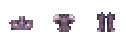

# Nyuu Terraria

An early-game content mod for **tModLoader 1.4.5-dev**.

[Download NyuuTerraria.tmod](https://github.com/Nyuukoria/Nyuu-Terraria/raw/refs/heads/main/downloads/NyuuTerraria.tmod). Put it in `Documents\My Games\Terraria\tModLoader-dev\Mods`, then enable **Nyuu Terraria** in **Manage Mods**. For multiplayer, everyone should use the same tModLoader build and mod file.

## v0.2.3

- Retinted the Skylight artwork to match the earlier Democloud gear, with cool violet shadows and pale cloud highlights.

| Added | What it does and how to get it |
| --- | --- |
|  **Stormglass** | Mine it in cavern stone in new worlds. At a Furnace, smelt **3 Stormglass Ore**, or combine **1 Skylight Bar + 1 Demonite Bar + 2 Cloud** in an existing world. |
|  **Frostveil** | Mine it underground in snow and ice in new worlds. At a Furnace, smelt **3 Frostveil Ore**, or combine **1 Skylight Bar + 6 Ice Blocks** in an existing world. |
|  **Stormglass Scepter** | **34 magic damage** and **4 mana per cast**. Its frost arc pierces up to three enemies, and holding the scepter boosts mana regen. At an anvil, use **8 Stormglass Bars + 12 Cloud + 2 Fallen Stars**. |
|  **Frostveil Blade** | **38 melee damage** and a piercing frost crescent. At an anvil, use **9 Frostveil Bars + 10 Cloud**. |
|  **Cloudweave Belt and two trinket slots** | Equip the belt in a normal accessory slot to enable two additional Sky Trinket slots. At an anvil, use **4 Skylight Bars + 12 Cloud + 5 Silk**. |
|  **Starfall Pendant and Frostveil Sigil** | At an anvil, make the mana and crit pendant with **3 Stormglass Bars + 2 Fallen Stars**, or the **+2 defense** and Chilled immunity sigil with **3 Frostveil Bars + 8 Snow Blocks**. |
|  **Cloudvault** | A **160-slot** chest. Scroll over the chest slots to reach the lower rows. At a Work Bench, use **1 Skylight Chest + 4 Stormglass Bars + 4 Frostveil Bars + 10 Cloud**. |
|  **Cloud Satchel** | Summons access to your personal Piggy Bank storage. At a Loom, use **4 Skylight Bars + 8 Cloud + 6 Silk**. |
|  **Three hairstyles** | Choose **Cloudside Ponytail**, **Moonbuns**, or **Lavender Braid** at the Stylist or during character creation. |

## v0.2.2

- Redrew the Skylight ore, weapons and spells, Nimbus Warden, armor, trinkets, vanity, hairstyles, and chest.

## v0.2.1

- Fixed loading on the updated 1.4.5-dev build. The **Warden armor** and **Yuuki’s boots** now use the current armor set API.

## v0.2.0

| Added | What it does and how to get it |
| --- | --- |
|  **Skylight Ore and Bars** | Mine Skylight Ore underground in new worlds and smelt **3 Ore** per bar at a Furnace. In existing worlds, smelt **2 Iron or Lead Bars + 3 Cloud** instead. |
|  **Dawnpetal Staff** | Fires ember bolts that ignite enemies. At an anvil, use **5 Skylight Bars + 3 Daybloom + 8 Wood**. |
|  **Stormweaver Staff** | Fires a fan of three piercing bolts. At an anvil, use **7 Skylight Bars + 4 Warden Cores + 15 Cloud**. |
|  **Skylight Saber** | Ignites enemies and scatters gold sparks. At an anvil, use **7 Skylight Bars + 1 Fallen Star**. |
|  **Nimbus Warden** | At an anvil, craft a **Cloud Idol** with **30 Cloud + 3 Skylight Bars**. Use it aboveground or in the sky to summon the Warden and fight for Warden Cores. |
|  **Warden armor** | The full set gives **12% lower mana cost** and **+6 percentage points of magic crit**. At an anvil, craft the crown, mantle, and greaves with **5, 8, and 6 Skylight Bars**, respectively, plus **2 Warden Cores per piece**. |
|  **Trinkets and two slots** | At an anvil, make the **Glowglass Lens** for night vision with **2 Skylight Bars + 1 Lens + 3 Glowsticks**, the **Petal Brooch** for magic damage and mana regen with **3 Skylight Bars + 2 Daybloom**, and the **Nimbus Charm** for movement and jumping with **3 Warden Cores + 8 Cloud**. |
|  **Cloudtail outfit** | Craft the **Cloud Beret**, **Cloudtail Coat**, and **Cloudtail Trousers** at a Loom. Each piece takes **5 Silk + 3 Cloud**. |
|  **Two hairstyles** | Choose **Petal Bob** or **Storm Tuft** in character creation or at the Stylist. |
|  **Skylight Chest** | Craft the brass-trimmed storage chest at a Work Bench with **8 Wood + 2 Skylight Bars**. |

### Summoning and fighting Nimbus Warden

1. Craft a **Cloud Idol** at an **Iron or Lead Anvil** with **30 Cloud + 3 Skylight Bars**.
2. Use it aboveground or in the sky. A long platform with a second level gives you room to run and change height.
3. **Keep moving sideways during the volleys.** When the Warden lines up for a dive, leave its path and fire into it as it passes. Keep a little distance so you can see the next volley coming.
4. **Below half health**, it dives faster and fires a wider spread. Save wing flight for dodging those attacks. The **Dawnpetal Staff** works before your first kill, and the **Staff of Democloud** is an upgrade if you already have it. Use the dropped **Warden Cores** to craft Stormweaver gear afterward.

## v0.1.x

| Added | What it does and how to get it |
| --- | --- |
|  **Wings of Democloud** | Early flight, gliding, and **+3 defense**. At an anvil, use **20 Cloud + 10 Demonite Bars**. |
|  **Staff of Democloud** | A rapid-fire magic staff with **50 base damage**, **4 mana per cast**, **30% crit** before bonuses, and mana regen while held. Its piercing comets can split on hit. At an anvil, use **25 Demonite Bars + 50 Cloud + 15 Wood**. |
|  **Yuuki’s Anti Fall Damage Boots** | Prevent fall damage, leave cloud puffs, and count toward the Shadow armor set. At an anvil, use **15 Demonite Bars + 10 Shadow Scales + 10 Cloud**. |
|  **Cloudy Bomb and Sticky Cloudy Bomb** | A **28-tile blast radius** for terrain and enemies, with player immunity. Craft from **1 Bomb + 4 Cloud + 4 Silver Bars**. Combine **1 Cloudy Bomb + 1 Gel** for the sticky version. |
| **Steam achievement sync** | Launch tModLoader through Steam. The mod forwards completed vanilla Terraria achievements when you enter a world or earn them during play. |

To contribute, copy the `NyuuTerraria` source folder into `tModLoader-dev\ModSources`, then select **Build + Reload** in tModLoader.
