

  

  <h1>Nyuu Terraria</h1>

  
<strong>Cloud-born magic. Crystal caverns. Stories beyond the mirror.</strong>

  
An early-game adventure that grows with you: explore, craft, meet Lyra, and make your character your own.

  

    <code>v0.4.1 · Spellcraft</code>
    &nbsp;
    <code>tModLoader 1.4.5-dev</code>
  

  

    <a href="https://github.com/Nyuukoria/Nyuu-Terraria/raw/refs/heads/main/downloads/NyuuTerraria.tmod"><strong>Download the mod</strong></a>
    &nbsp; · &nbsp;
    <a href="downloads/NyuuTerraria-Source.zip">Source ZIP</a>
    &nbsp; · &nbsp;
    <a href="#getting-started">Start playing</a>
    &nbsp; · &nbsp;
    <a href="#roadmap">Roadmap</a>
  

  

    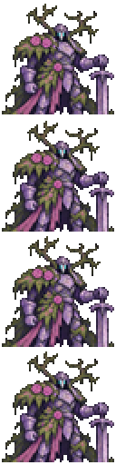
    &nbsp;&nbsp;
    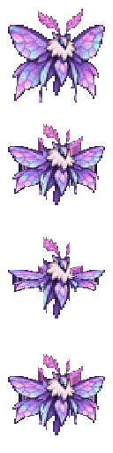
    &nbsp;&nbsp;
    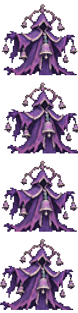
  

  
<kbd>K</kbd> Spellbook &nbsp; · &nbsp; <kbd>J</kbd> Quests &amp; professions &nbsp; · &nbsp; <kbd>V</kbd> Backpack

| Explore somewhere new | Make your own build | Bring something home |
| :---: | :---: | :---: |
| **7 ores · 2 cave biomes** Reverie & Hush pocket expeditions | **5 professions · 12 quests** Pride customization & 8 long hairstyles | **6 bosses · 3 minibosses** Pets, equipment & backpacks up to 100 slots |

## Find what you need

| Start your adventure | Explore & fight | Craft & customize |
| --- | --- | --- |
| [Install & multiplayer](#install-and-play) [First steps](#getting-started) [New: v0.4.1 Spellcraft](#spellcraft) [v0.4.0 Expeditions](#chronicle-expeditions) | [Material locations](#where-to-find-materials) [Cave bosses](#boss-progression) [Expedition encounters](#expedition-bosses-and-minibosses) | [Backpacks](#backpacks) [All crafting recipes](#complete-crafting-guide) [Expedition recipes](#every-expedition-crafting-recipe) |
| [Quests & professions](#journal-stories-and-professions) [Lyra, hairstyles & outfits](#lyra-pride-hairstyles-and-clothing) | [Amber Grotto](#amber-grotto) [Hollowglass Reach](#hollowglass-reach) | [Trinkets, storage & reforging](#using-the-new-features) [Build & contribute](#building-from-source) |

[Need help?](#quick-fixes) · [Roadmap](#roadmap) · [Version history](#version-notes)

## Install and play

1. [Download `NyuuTerraria.tmod`](https://github.com/Nyuukoria/Nyuu-Terraria/raw/refs/heads/main/downloads/NyuuTerraria.tmod).
2. Place it in `Documents\My Games\Terraria\tModLoader-dev\Mods`.
3. Open **Workshop → Manage Mods**, enable **Nyuu Terraria**, then reload mods.

**Playing with friends?** Use the same tModLoader dev build and mod file on the server and every client.

| Your world | How to access the new content |
| --- | --- |
| **New world** | Natural ore veins, Amber Grottos, and Hollowglass ruins appear when you create a world. Explore the Underground and Cavern layers. |
| **Existing world** | Use the alternate bar recipes and craft biome blocks to build underground areas. The [Amber Grotto](#amber-grotto) and [Hollowglass Reach](#hollowglass-reach) sections give the block counts and recipes. |

## Getting started

1. **Make Skylight Bars.** Smelt 3 Skylight Ore per bar, or use 2 Iron or Lead Bars + 3 Cloud at a Furnace.
2. **Pick an early upgrade.** Dawnpetal Staff gives a first magic weapon. Glowglass Lens helps you see underground. A Copper Backpack adds 20 storage slots.
3. **Choose a cave route.** Amber Grotto supplies mining gear, regeneration accessories, and two pet drops. Hollowglass Reach supplies crystal weapons and a two-boss progression.
4. **Prepare for a boss.** Nimbus Warden opens Warden armor and Stormweaver gear. Prism Sentinel opens Mourning Bell, whose drops craft Hollowchime Staff and a bell pet.
5. **Upgrade in Hardmode.** Combine Amberheart Pendant with Souls of Light, Souls of Night, and Ember Amber Bars to make Deepheart Pendant.

Follow the ingredient and crafting-station tables below for exact recipes.

## v0.4.1 — Spellcraft

**One wand. Six spells. A ward between you and danger.** Learn elemental tomes, build mastery through combat, and turn a quick cast into a glowing charged bloom.

### Start casting

1. Craft the **Aetherloom Wand** at an Iron or Lead Anvil: **3 Skylight Bars + 8 Wood + 2 Fallen Stars**. Arcane Thread and Crescent Ward are known from the start.
2. Press **K** to open the Spellbook, or choose its tab in the **J** journal. Select a learned spell, then left-click with the wand to cast it.
3. Craft and use a learning tome once to unlock its spell for that character. You keep learned spells and mastery when switching spells or worlds.
4. **Hold left-click for Emberbloom**, then release to fire. Hold **right-click for Crescent Ward** with any selected spell.

K works without carrying the craftable Nyuu Spellbook. Change keys in **Settings → Controls → Mod Controls** if another mod uses them.

### Spells and effects

Values below are the base values before reforges, equipment, and mastery. Attack timing is in game ticks; 60 ticks is one second. The wand has **20% base total critical chance**, moderate knockback, and accepts normal magic reforges.

| Spell | Base damage | Mana | Cast timing | What it does |
| --- | ---: | ---: | --- | --- |
|  **Arcane Thread** | 36 | 4 | 12 ticks | A fast lilac bolt with a connected pink-and-cyan trail. Known immediately. |
|  **Emberbloom** | 49 | 7 + charging | Hold up to 90 ticks | A burning bloom that detonates on impact. A full charge adds up to 75% shot damage; holding costs 2 more mana every 20 ticks before mana reductions. The blast harms enemies and leaves terrain intact. |
|  **Frostbloom** | 31 | 5 | 15 ticks | A frostburn shard that pierces three enemies. At mastery 5 it becomes a three-shot fan, each dealing 70% shot damage. |
|  **Tideglass** | 40 | 6 | 22 ticks | A piercing water orb that applies Wet and releases three weaker droplets on a hit. Droplets cannot split again. |
| 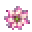 **Dawnmend** | Healing | 18 | 30 ticks; 8-second cooldown | Restores 10 life + 1 per mastery, with a petal rune effect. Cannot be used at full health or during its cooldown. |
| 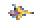 **Stormglass Fork** | 46 | 6 | 16 ticks | Lightning chains to 2 extra enemies, rising to 4 at mastery 8. Targets must be within 260 pixels of the previous target with line of sight. Links deal 60% shot damage, or 80% against Wet enemies. |
| 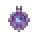 **Crescent Ward** | Defensive | 2 to raise, then 2 / 12 ticks | Hold right-click | Blocks one eligible projectile in front of you, then recovers for 12 ticks. Stops when you release, swap items, or run out of mana. |

Offensive bolts travel up to roughly **2,080 pixels** before timing out, unless terrain or penetration ends them sooner. Trails, impact circles, bloom bursts, lightning links, and ward rings each use their element's palette.

**Ward limits:** contact damage, attacks from behind, slow or stationary hazards, large projectiles, important boss projectiles, and attacks dealing 120 or more projectile damage can pass through. This is a directional defense, not invulnerability. Equip Ward Sigil to halve its continuing cost; mana reductions apply, with a minimum of 1 mana per payment.

### Learning and mastery

Each spell has its own saved XP and level. Damaging real enemies builds combat mastery; successful ward blocks build ward mastery; successful healing builds Dawnmend mastery. Statue enemies do not grant combat mastery, and repeated hits on the same enemy have a short XP lockout.

- **Level cap:** 5 before Hardmode, 10 in Hardmode. Advanced mastery stays saved when visiting a pre-Hardmode world; its effective power is capped there.
- **Damage:** +3% per effective mastery level for offensive spells.
- **Threshold:** level L requires a total of **75 × L² XP**. The Spellbook displays your current level and next threshold.
- **Progress:** learned spells, selected spell, mastery, and Dawnmend cooldown belong to the character. Spell mastery is separate from profession ranks.

### Every Spellcraft recipe

| Item | Ingredients | Station / use |
| --- | --- | --- |
| 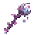 **Aetherloom Wand** | 3 Skylight Bars + 8 Wood + 2 Fallen Stars | Iron or Lead Anvil. Casts your selected spell; right-click holds Ward. |
| 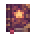 **Emberbloom Tome** | 1 Book + 2 Ember Amber Bars + 10 Torches | Iron or Lead Anvil. Use once to learn Emberbloom. |
| 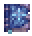 **Frostbloom Tome** | 1 Book + 3 Frostveil Bars + 5 Shiverthorn | Iron or Lead Anvil. Use once to learn Frostbloom. |
| 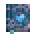 **Tideglass Tome** | 1 Book + 3 Moonprism Bars + 5 Coral + 3 Bottled Water | Iron or Lead Anvil. Use once to learn Tideglass. |
| 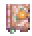 **Dawnmend Tome** | 1 Book + 2 Moonprism Bars + 5 Daybloom + 3 Lesser Healing Potions | Work Bench. Use once to learn Dawnmend. |
| 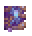 **Stormglass Tome** | 1 Book + 4 Stormglass Bars + 3 Fallen Stars + 1 Lens | Iron or Lead Anvil. Use once to learn Stormglass Fork. |
| 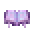 **Nyuu Spellbook** | 1 Book + 2 Silk + 2 Fallen Stars | Work Bench. Opens the Spellbook; K also works without it. |
|  **Ward Sigil** | 3 Moonprism Bars + 2 Lenses + 4 Silk | Iron or Lead Anvil. Accessory: +20 maximum mana and half continuing ward cost. Reforgeable. |

**Finding ingredients:** gather Books from Dungeon bookshelves, grow Daybloom and Shiverthorn from seeds, and collect Coral on ocean sand. Fallen Stars land at night; Demon Eyes drop Lenses; Silk comes from Cobwebs at a Loom. See [material locations](#where-to-find-materials) for Skylight, Ember Amber, Frostveil, and [expedition recipes](#every-expedition-crafting-recipe) for Moonprism alternatives.

**A useful combo:** apply Wet with Tideglass, then switch to Stormglass Fork for stronger chain links. Keep Arcane Thread for cheap quick casts, Frostbloom for lined-up enemies, and Dawnmend for recovery between attacks. Ward helps against small incoming shots; movement still matters against bosses.

<strong>Validation and current limits</strong>

The release compiles against tModLoader 1.4.5-dev build 25921d5f. Isolated server checks cover learning, save/load, mastery caps, reforges, ward blocking and mana shutdown, healing cooldowns, charged shots, chaining, and nonrecursive droplets. All new PNGs decode and use clean transparency. Rendered client effects, multiplayer play, and gameplay balance still need playtesting. See the [validation notes](docs/validation/0.4.1.md).

## v0.4.0 — Chronicle expeditions

This is the first playable chapter of the roadmap: **Lyra**, **12 quests**, **five switchable professions**, **eight long hairstyles**, new equipment, **three bosses and three minibosses**, and two portal expeditions.

<strong>View the v0.4.0 sprite gallery</strong> — equipment, encounters, wildlife & hairstyles

### Fixes included

<strong>Backpack, inventory & interface fixes</strong>

- The backpack remains in its existing saved slot, but is now displayed under **Equipment**, alongside pets and mounts. Click the Equipment tab in the inventory, then use the **Backpack** slot below those slots.
- Backpack clicks no longer use a vanilla bank-container action. This fixes the missing-container error that interrupted the panel and made slots flicker.
- Accessory/trinket wheel scrolling follows the expected direction. Custom bar sprites have a larger, consistently cropped inventory footprint.
- Backpack and Chronicle panels use Terraria's scaled UI coordinates once, keeping drawing and clicks aligned when you change UI scale.

### Your first expedition

1. Press **J** to open **Nyuu Chronicle**. A crafted Chronicle Journal also opens it.
2. Make a **Garden Mirror** at a Work Bench. Use it to enter **the Reverie**.
3. Mine **Moonprism Ore** under the orchard floor and smelt it at a Furnace. Look for the expedition chest near the landing area.
4. Follow Lyra's atelier requests in the journal, craft equipment, and challenge the **Reefback Guardian** or **Rootbound Knight**.
5. Craft a **Cracked Bell Portal** to enter **the Hush**. Bring healing items and a lantern. Its enemies provide Echo Fragments.
6. In Hardmode, challenge **the Bellkeeper**, **the Mirrorless**, and **Prism Matriarch**.

**Portal behavior:** use either key again while inside either expedition to return. Keys are reusable and cannot be used during a boss fight. In this release, these are **persistent pocket areas in unused sky space within your current world**, rather than separate world files. They have biome detection, enemies, resources, structures, loot, and combat platforms. The full separate-world dimensions, changing manor, mining town, and observatory remain future work.

Both areas are created only on their first visit and saved with the world. Their chests do not refill. Existing terrain and builds are checked before an area is placed; if no empty space fits, travel is refused without replacing terrain. Existing worlds can use this feature.

### Journal, stories, and professions

**J → Quests** shows objectives, prerequisite quests, progress, and rewards. Press **Claim** when ready. Gathering requests consume the listed inventory materials; exploration and combat requests consume nothing. Each reward can be claimed once per character. Combat credit goes to nearby players who helped damage that enemy; peaceful wildlife and statue enemies do not award combat XP.

The first 12 requests cover Lyra's atelier, the crystal orchard, the Rootbound Knight, entering the Hush, the Lantern Stalker, Bellkeeper, Matriarch, an enemy-clearance contract, and the Reefback challenge. Your completed requests and counters persist between worlds.

**J → Professions:** switch freely between the five professions. **Every profession saves its own XP, level, and invested skill points.** Switching does not erase any progress. Only your active profession grants its bonuses. Each level provides one point; use **+ Skill** to invest it or **Reset active skills** to redistribute that branch for free.

<strong>Profession bonuses, skill points & XP progression</strong>

| Profession | Initial skill effect per invested point |
| --- | --- |
| Vanguard | +0.5% melee damage; +1 defense for every five points |
| Ranger | +0.5% ranged damage |
| Arcanist | +0.5% magic damage and +1 mana regeneration bonus |
| Summoner | +0.5% summon damage |
| Explorer | +0.4% movement speed and +0.3% mining speed, with the mining bonus capped at 15% |

Levels currently cap at **50 per profession**. Total XP required for level L is **50 × L²**. Quests, hostile enemy defeats, and first expedition visits award XP to the selected profession. Moving through the expeditions as Explorer also awards a small amount of exploration XP. These are the first passive skills; active abilities and branching trees remain planned.

Your future dialogue and unique quests can be added through [the content authoring guide](docs/CONTENT-AUTHORING.md). Dialogue and quest definitions are kept separately from the journal code.

### Lyra, pride, hairstyles, and clothing

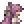 **Lyra, the Prism Tailor**, is a trans woman town NPC who can arrive when a suitable empty house is available. Talk to her for **Stories & quests**, or choose **Long hairstyles** repeatedly to cycle through all eight new styles for free. They are also available during character creation.

<strong>Preview all eight long hairstyles</strong>

| Style | Preview | Style | Preview |
| --- | --- | --- | --- |
| **Waistlength Waves** | 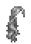 | **Twin Ribbon Braids** | 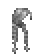 |
| **Silken Curtain** | 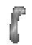 | **Moonlit Curls** | 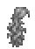 |
| **Trailing Ponytail** | 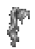 | **Cascading Layers** | 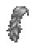 |
| **Long Side Braid** | 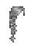 | **Halfup Ribbon** | 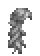 |

The **Pride Ribbon** gives cyan and pink sparkles when visible. **Prism Longcoat** and **Prism Skirt** go in body and leg **vanity** slots. All styles and clothes are available to every character.

Place a **Prism Wardrobe** and right-click it to open **J → Wardrobe**. Save up to **three appearance presets** containing hair, colors, and body appearance. Stand near that wardrobe to restore a preset. These presets do not duplicate or replace inventory/armor items. Choose pronouns in the same tab, or use **/nyuuprofile she/her** (any short custom value is accepted). Lyra's authored dialogue can use your character name and pronouns.

### Expedition materials and inhabitants

<strong>Where to find materials, enemies & peaceful wildlife</strong>

| Material or creature | Where to find it / what it does |
| --- | --- |
|  **Moonprism Ore** | Mine crystal clusters beneath the Reverie's orchard floor. Glass Serpents can drop 1–3, and the first expedition chest contains 18. |
|  **Moonprism Bar** | Smelt 3 Moonprism Ore at a Furnace. Used for early expedition equipment and the Hush portal. |
| 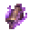 **Echo Fragment** | Hush chest and hostile Hush inhabitants. The Rootbound Knight and Bellkeeper also drop 12–18. |
|  **Prism Wing Scale** | Rootbound Knight drops 5–8; Prism Matriarch drops 12–18. Used for the Matriarch summon. |
| 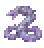 **Glass Serpent** | Hostile Reverie creature: 180 base HP, 30 contact damage. |
| 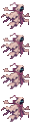 **Paper Wraith** | Hostile Hush creature: 280 base HP, 30 contact damage; periodically fires an aimed echo. |
| 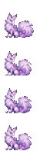 **Dew Fox**, 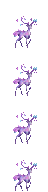 **Glass Deer** | Peaceful Reverie wildlife. |
| 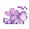 **Mothcat**,  **Mooncap Sprite** | More peaceful Reverie wildlife. Feeding and garden interactions are future additions. |

The Reverie chest also contains a **Dew Berry Charm**, five Healing Potions, and a **Prism Cocoon**. The Hush chest contains **18 Echo Fragments**, an **Archive Lantern**, five Healing Potions, and a **Cracked Bell Sigil**. Hardmode summons still require Hardmode even when found early.

### Expedition bosses and minibosses

<strong>Summons, health, rewards & fight tips</strong>

Health below is the normal base value before difficulty/player adjustments. The original bosses also gained health: **Nimbus Warden 5,600**, **Prism Sentinel 7,200**, and **Mourning Bell 10,400**.

| Encounter | Where / how to summon | Base HP | Rewards and fight advice |
| --- | --- | --- | --- |
| 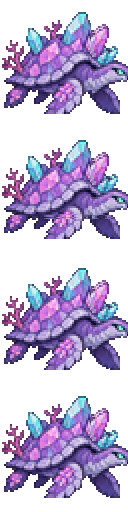 **Reefback Guardian — miniboss** | Use **Reef Shell** in the Reverie | 3,200 | 10–18 Moonprism Ore and 8–16 Coral. Use the platforms to change height as it prepares its charge. |
| 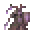 **Rootbound Knight** | Use **Rootbound Seal** in the Reverie | 10,000 | 5–8 Prism Wing Scales, 12–18 Echo Fragments, 18–30 Moonprism Ore. Its defense falls from 32 to 8 after the hovering phase. Dodge the charge, then attack during its recovery. |
| 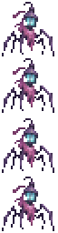 **Lantern Stalker — miniboss** | Rare natural Hush spawn | 4,200 | Archive Lantern and 1–3 Echo Fragments. It is translucent while stalking, then becomes visible and speeds up before its charge. Keep space around yourself. |
| 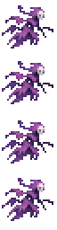 **The Mirrorless — miniboss** | Rare natural Hush spawn in **Hardmode** | 6,500 | 1–3 Echo Fragments; 1-in-3 chance for Echo Scythe. Circle around its hovering path and move aside for aimed shots. |
| 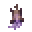 **The Bellkeeper** | Use **Cracked Bell Sigil** in the Hush, **Hardmode** | 19,000 | Echo Scythe, 12–18 Echo Fragments, 18–30 Moonprism Ore. Stay away from the center of each ring, move through a gap, and save room to dodge its charge. |
| 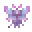 **Prism Matriarch** | Use **Prism Cocoon** in the Reverie, **Hardmode** | 24,000 | 12–18 Prism Wing Scales, Pride Moth Charm, and Prism Moth Staff. Alternate between platform levels to avoid rings and aimed five-shot fans. |

**Preparation:** bring healing potions, useful accessories, and a mobility option. The expedition areas already have three central platform levels. A piercing staff, Moonprism Bow, or a summon can keep damage going while you dodge. Below half health, the ring patterns and charges become faster.

**Hush jumpscares:** while exploring the Hush, a brief Lantern Stalker apparition and sound can occur after you have been inside for a short time. There is a cooldown between scares. It does not deal damage or lock movement. Toggle **Hush Jumpscares** in the mod's client settings.

### Every expedition crafting recipe

<strong>Open all 24 expedition recipes</strong>

“Anvil” means an Iron or Lead Anvil. Unless stated otherwise, recipes produce one item.

| Item | Station | Ingredients | Use |
| --- | --- | --- | --- |
| 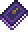 **Chronicle Journal** | Work Bench | 8 Wood + 2 Silk | Open quests, professions, and presets; J works without carrying it. |
| 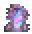 **Garden Mirror** | Work Bench | 20 Glass + 5 Fallen Stars + 8 Silk | Reusable Reverie travel key and realm exit. |
| 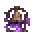 **Cracked Bell Portal** | Anvil | 6 Moonprism Bars + 20 Obsidian + 10 Bone | Reusable Hush travel key and realm exit. |
|  **Moonprism Bar** | Furnace | 3 Moonprism Ore | Equipment material. |
|  **Prism Wardrobe** | Work Bench | 25 Wood + 10 Glass + 5 Silk | Place and right-click for appearance presets. |
| 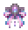 **Pride Ribbon** | Loom | 3 Silk + 1 Fallen Star | Wearable pride sparkles. |
| 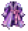 **Prism Longcoat** | Loom | 10 Silk + 2 Moonprism Bars | Body vanity clothing. |
| 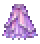 **Prism Skirt** | Loom | 10 Silk + 2 Moonprism Bars | Leg vanity clothing. |
| 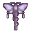 **Prism Moth Staff** | Anvil | 10 Moonprism Bars + 4 Fallen Stars + 12 Wood | 42 base magic damage, 5 mana, use time 12; piercing moth bolts and a colored trail. |
| 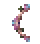 **Moonprism Bow** | Anvil | 7 Moonprism Bars + 12 Wood | 27 base ranged damage; consumes arrows and turns them into piercing bolts. |
| 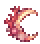 **Coral Boomerang** | Work Bench | 8 Coral + 15 Wood | 22 base melee damage; returns after flying out or hitting terrain. |
| 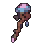 **Mooncap Scepter** | Anvil | 5 Moonprism Bars + 15 Glowing Mushrooms + 10 Wood | 19 base summon damage; one minion slot per Mooncap. |
| 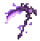 **Echo Scythe** | Anvil | 12 Echo Fragments + 8 Moonprism Bars | 56 base melee damage; sends out a spinning spectral blade. |
| 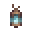 **Archive Lantern** | Anvil | 4 Echo Fragments + 5 Torches + 3 Iron or Lead Bars | Accessory granting night vision and light. |
| 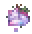 **Dew Berry Charm** | Work Bench | 3 Moonprism Bars + 3 Daybloom | Dew Fox pet. |
| 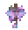 **Pride Moth Charm** | Loom | 8 Silk + 4 Moonprism Bars | Glowing Pride Moth pet. |
|  **Reef Shell** | Work Bench | 10 Coral + 3 Seashells | Reefback Guardian summon. |
| 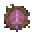 **Rootbound Seal** | Anvil | 5 Moonprism Bars + 3 Vines | Rootbound Knight summon. |
| 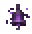 **Cracked Bell Sigil** | Anvil | 8 Echo Fragments + 10 Obsidian | Bellkeeper summon; use in Hardmode. |
|  **Prism Cocoon** | Anvil | 6 Prism Wing Scales + 5 Souls of Light | Prism Matriarch summon; use in Hardmode. |
|  **Prism Memorial** | Work Bench | 20 Stone Blocks + 2 Moonprism Bars + 2 Daybloom | Engravable decorative crystal memorial. |
|  **Copper Memorial** | Work Bench | 4 Copper Bars + 15 Stone Blocks | Engravable memorial with a plaque. |
|  **Obsidian Memorial** | Work Bench | 15 Obsidian + 2 Daybloom | Engravable flower-covered memorial. |
|  **Reverie Vase** | Furnace | 5 Clay Blocks + 1 Moonprism Ore | Decorative furniture; also placed in the expeditions. |

Right-click a memorial to read/edit its inscription using the sign interface. These are crafted decorations; automatic death-grave variants and retrieval quests remain planned.

## Boss progression

These are the original cave and cloud encounters. For the Reverie and Hush fights, see [expedition bosses and minibosses](#expedition-bosses-and-minibosses).

| Boss | Where to summon | Summon item | Main rewards |
| --- | --- | --- | --- |
|  **Nimbus Warden** | Aboveground or in the sky | **Cloud Idol** — 30 Cloud + 3 Skylight Bars at an anvil | Warden Cores for armor, Stormweaver Staff, and Nimbus Charm. [Fight guide](#summoning-and-fighting-nimbus-warden) |
|  **Prism Sentinel** | Hollowglass Reach | **Glassbound Seal** — 4 Hollowglass Bars + 2 Fallen Stars at an anvil, or find one in a Reach chest | Prism Hearts for Resonance Charm and Resonating Bell. [Fight guide](#prism-sentinel) |
|  **Mourning Bell** | Hollowglass Reach | **Resonating Bell** — 3 Prism Hearts + 5 Hollowglass Bars + 10 Obsidian at an anvil | Resonant Clappers for Hollowchime Staff and Pocket Chime. [Fight guide](#mourning-bell) |

**Hollowglass route:** Prism Sentinel → Prism Hearts → Resonating Bell → Mourning Bell. Nimbus Warden has its own crafting route. All three are pre-Hardmode encounters.

## Backpacks

Open the inventory's **Equipment** tab (the tab containing pets and mounts). Equip one backpack in the dedicated **Backpack** slot below those slots, then press **V** to open or close its window. You can change the binding under Controls. Use the arrow buttons to change pages when the pack has more than 50 slots.

| Backpack | Extra slots | Full recipe at an Iron or Lead Anvil |
| --- | --- | --- |
|  **Copper** | **20** | 12 Copper Bars + any chest |
|  **Iron** | **30** | 12 Iron Bars + 1 Copper Backpack |
|  **Gold** | **40** | 12 Gold Bars + 1 Iron Backpack |
|  **Emerald** | **60** | 8 Emeralds + 1 Gold Backpack |
|  **Obsidian** | **80** | 30 Obsidian + 1 Emerald Backpack |
|  **Demonite** | **100** | 20 Demonite Bars + 1 Obsidian Backpack |

**Upgrade order — Copper → Iron → Gold → Emerald → Obsidian → Demonite.** Each upgrade consumes the previous backpack. “Any chest” includes vanilla placeable chests and the mod’s Skylight Chest, Cloudvault, and Reach Chest.

**Using it:** equip the pack, press **V**, and move items into its slots. Contents belong to your character and carry over between worlds. **Every backpack storage slot must be empty before crafting an upgrade**, including overflow slots. Empty it into your inventory or a [Cloudvault](#work-bench-loom-and-hand-crafting), move the old backpack from its equipment slot into your inventory, craft the next tier, and equip the result.

Switching to a smaller pack or removing it still leaves over-capacity items available to withdraw with an empty cursor. Those items also need to be withdrawn before an upgrade becomes available.

## Hollowglass Reach

 

Explore the **Cavern layer** of a new world for chambers of dark **Glass Slate**, turquoise lanterns, and crystal ore. Ruin chests contain **12–18 Hollowglass Ore**, **1 Glassbound Seal**, **2 Spelunker Potions**, and **3 Healing Potions**.

For an existing world, make **10 Glass Slate** from **10 Stone Blocks + 2 Glass** at a Furnace. Place **100 nearby Glass Slate or Hollowglass ore blocks** underground to activate Hollowglass Reach. Use Glass Slate floors for its enemies to spawn on.

| Find | Where and what it gives |
| --- | --- |
|  **Hollowglass Ore** | Mine veins in the Reach or search its chests and vases. Smelt **3 Ore** per bar at a Furnace. |
|  **Glass Crawler** | Spawns on Glass Slate. **82 base HP, 22 contact damage, 8 defense**. Base **1-in-2** chance to drop **1–3 Hollowglass Ore**. |
|  **Glasswing Moth** | Spawns on Glass Slate. **65 base HP, 20 contact damage, 5 defense**. Base **1-in-2** chance to drop **1–2 Hollowglass Ore**. |
|  **Glass Vase** | Break for one of four equally likely drops: **2 Healing Potions**, **3 Hollowglass Ore**, **1 Spelunker Potion**, or **10 Silver Coins**. The vase is consumed. |

### Prism Sentinel

Craft **Glassbound Seal** at an anvil with **4 Hollowglass Bars + 2 Fallen Stars**, or find one in a natural Reach chest. Use it while standing in **Hollowglass Reach** to summon the Sentinel.

It fires three-shot crystal fans while hovering, then pauses and glows amber before charging. Run across a platform during the volleys, and change height when it stops to prepare the charge. Its defense falls during the charge phase, giving you an opening to attack. Below half health its volleys and charges get faster.

The Sentinel has **7,200 base HP**, **28 contact damage**, and **16 defense while hovering**, falling to **5 during the charge phase**. It drops **7–11 Prism Hearts** and **12–20 Hollowglass Ore**. Use the hearts for a Resonance Charm or the second boss summon.

### Mourning Bell

At an anvil, combine **3 Prism Hearts + 5 Hollowglass Bars + 10 Obsidian** into a **Resonating Bell**. Use it in **Hollowglass Reach**.

The Bell sways before releasing rings of crystal shots, then fires aimed bolts. Keep enough space to see gaps between the ring shots and move through a gap while keeping your distance from the center. Change direction for the aimed bolts. Below half health the attack cycle speeds up.

It has **10,400 base HP**, **33 contact damage**, and **12 defense**. It drops **7–11 Resonant Clappers** and **12–20 Hollowglass Ore**. Clappers craft the Hollowchime Staff and the Little Glass Bell pet.

### Reach recipes

<strong>Hollowglass equipment, summons & pet recipes</strong>

| Result | Station | Ingredients | What it does |
| --- | --- | --- | --- |
|  **Glass Slate ×10** | Furnace | 10 Stone Blocks + 2 Glass | Biome building blocks. |
|  **Hollowglass Bar** | Furnace | 3 Hollowglass Ore, or 4 Glass + 1 Silver or Tungsten Bar + 1 Amethyst | Reach crafting material. |
| **Glass Vase** | Furnace | 4 Glass + 1 Hollowglass Ore | A breakable supply vase. |
|  **Reach Lantern** | Work Bench | 1 Hollowglass Bar + 2 Torches | Placeable turquoise cave light. |
|  **Reach Chest** | Work Bench | 8 Glass Slate + 2 Hollowglass Bars | A 40-slot chest. Crafted chests start empty. |
|  **Glassbound Seal** | Anvil | 4 Hollowglass Bars + 2 Fallen Stars | Summons Prism Sentinel in the Reach. |
|  **Resonating Bell** | Anvil | 3 Prism Hearts + 5 Hollowglass Bars + 10 Obsidian | Summons Mourning Bell in the Reach. |
|  **Glassedge Blade** | Anvil | 8 Hollowglass Bars + 2 Emeralds | **31 melee damage** and a piercing glass blade projectile. |
|  **Resonance Charm** | Anvil | 4 Prism Hearts + 4 Hollowglass Bars | **+2 defense**, **+20 maximum mana**, **+4 percentage points of magic crit**. Uses a normal accessory slot. |
|  **Hollowchime Staff** | Anvil | 5 Resonant Clappers + 10 Hollowglass Bars + 3 Fallen Stars | **56 magic damage**, **6 mana per cast**. Its gently homing shots can pierce two enemies. |
|  **Pocket Chime** | Anvil | 2 Resonant Clappers + 3 Hollowglass Bars | Use to summon a glowing Little Glass Bell vanity pet. |

Both summons are consumed on use and require the Reach biome. The second summon uses a first-boss drop. Both bosses are pre-Hardmode encounters.

## Where to find materials

<strong>Open the complete material location guide</strong>

| Material | Where to look |
| --- | --- |
|  **Glass Slate** | Mine dark turquoise stone in Hollowglass Reach, or craft 10 from 10 Stone Blocks + 2 Glass at a Furnace. |
|  **Hollowglass Ore** | Hollowglass Reach veins, enemies, chests, and vases. See the [Reach recipes](#reach-recipes) for its alternate bar recipe. |
|  **Skylight Ore** | Stone in the Underground and upper Cavern layers of new worlds. |
|  **Stormglass Ore** | Cavern stone in new worlds, deeper than the first Skylight veins. |
|  **Frostveil Ore** | Underground snow and ice in new worlds. |
|  **Verdigris Ore** | Moss Slate pockets in Amber Grottos. Mossback Beetles can also drop it, and it can be found in Amber Urns. |
|  **Ember Amber Ore** | Amber Grottos. The amber veins give off a faint glow. Lantern Moths can also drop it. |
|  **Moss Slate** | Mine the green-gray stone around an Amber Grotto, or craft it at a Work Bench. |
|  **Warden Core** | Defeat Nimbus Warden for **9–14 cores**. The staff, armor pieces, and charm all use them. |
|  **Cloud** | Mine the fluffy blocks on Floating Islands. |
|    **Wood, Gel, and Bombs** | Chop trees for Wood and fight Slimes for Gel. Look for Bombs in pots and chests, or buy them from the Demolitionist. |
|       **Copper, Iron, Lead, Silver, Gold, and Platinum Bars** | Mine and smelt the corresponding ores at a Furnace. Recipes that list alternatives accept either named bar. The alternate Verdigris recipe specifically requires **Copper**, and Cloudy Bombs specifically require **Silver**. |
|   **Demonite Bars and Shadow Scales** | Smelt Demonite Ore into bars at a Furnace. Eater of Worlds is a source of Demonite Ore and Shadow Scales. |
|   **Ice Blocks and Snow Blocks** | Mine in the Snow biome. The Frostveil Bar recipe takes **Ice Blocks**, and the Frostveil Sigil takes **Snow Blocks**. |
|    **Glowing Mushrooms, Amber, and Clay** | Look underground for Glowing Mushroom biomes. Mine Amber in the Underground Desert, or process Silt, Slush, or Desert Fossil in an Extractinator. Clay occurs in reddish deposits. [Amber sources](https://terraria.wiki.gg/wiki/Amber) |
|     **Daybloom, Fallen Stars, Lenses, and Glowsticks** | Gather Daybloom from surface grass, pick up Fallen Stars at night, fight Demon Eyes for Lenses, and look for Glowsticks in pots or buy them from the Merchant at night. |
|    **Leather, Emeralds, and Obsidian** | This mod adds a Work Bench recipe for Leather using **8 Gel + 1 Silk**. Find Emeralds underground. Obsidian forms where water meets lava. |
|   **Silk and Chains** | Make Silk from Cobwebs at a Loom. Make Chains from Iron or Lead Bars at an anvil. |
|   **Souls of Light and Night** | In Hardmode, fight enemies in the Cavern layer of the Hallow for Light and the Corruption or Crimson for Night. |

## Amber Grotto

In a new world, look for **Moss Slate** near the Cavern layer. Follow the green-gray rock and the glow of Ember Amber to find the chamber. The biome activates in the Underground or Cavern layer with at least **85 nearby Moss Slate or Grotto ore blocks**.

For an existing world, use a **Work Bench** to turn **10 Stone Blocks + 1 Glowing Mushroom** into **10 Moss Slate**. Build an underground area with at least 85 nearby Grotto blocks. Use Moss Slate for exposed floors so the cave enemies have places to spawn.

| Find | What you can get |
| --- | --- |
|  **Mossback Beetle** | Spawns on Moss Slate underground. Base stats are **65 HP, 19 contact damage, 7 defense**. Drops **1–3 Verdigris Ore** with a base **1-in-2** chance, and **Glowcap Spore** with a base **1-in-14** chance. |
|  **Lantern Moth** | Spawns on Moss Slate underground. Base stats are **48 HP, 16 contact damage, 3 defense**. Drops **1–2 Ember Amber Ore** with a base **1-in-2** chance, and **Amber Wisp Seed** with a base **1-in-14** chance. |
|  **Amber Urn** | Break it for one of five drops. Each has a **1-in-5** chance: **2 Recall Potions**, **3 Lesser Healing Potions**, **8 Glowsticks**, **3 Verdigris Ore**, or **5 Silver Coins**. The urn is consumed when broken. |
|  **Glowcap Firefly** | Use a **Glowcap Spore** from a Mossback Beetle to summon this teal-glowing vanity pet. |
|  **Amber Wisp** | Use an **Amber Wisp Seed** from a Lantern Moth to summon this amber-glowing vanity pet. |

## Summoning and fighting Nimbus Warden

1. At an **Iron or Lead Anvil**, craft a **Cloud Idol** from **30 Cloud + 3 Skylight Bars**.
2. Use it aboveground or in the sky. It is consumed when summoning. A long two-level platform gives you room to run and change height.
3. The Warden hovers, fires volleys, then dives. Run sideways during volleys. Move out of the dive path as it lines up, then attack while it passes.
4. **Below half health**, the Warden dives faster and fires wider volleys. Save flight for dodging. The **Dawnpetal Staff**, **Amberflare Staff**, or **Staff of Democloud** are all craftable before the fight. Stormweaver gear requires cores from a kill.

The Warden has **5,600 base HP**, **26 base contact damage**, and **9 defense**. It drops **9–14 Warden Cores** per kill before any difficulty-specific adjustments. The three armor pieces use six cores in total. The staff and charm use another seven.

## Complete crafting guide

Choose a station below to open its recipe book. For Moonprism gear, pride items, portals, and memorials, use the [expedition recipe book](#every-expedition-crafting-recipe).

[Bars and Furnace recipes](#furnace) · [Weapons and tools](#anvil-weapons-and-tools) · [Armor](#anvil-armor) · [Accessories](#anvil-accessories-trinkets-and-boss-summon) · [Hardmode upgrade](#mythril-or-orichalcum-anvil) · [Storage, vanity, and bombs](#work-bench-loom-and-hand-crafting)

Backpack recipes are in [Backpacks](#backpacks). Hollowglass equipment and summons are in [Reach recipes](#reach-recipes).

All recipes below produce **one item** unless a quantity is shown. “Anvil” means an **Iron or Lead Anvil**. Weapon values are base stats before reforges and player bonuses.

### Furnace

<strong>Ore-to-bar recipes & alternate crafting routes</strong>

| Result | Ingredients |
| --- | --- |
|  **Skylight Bar** | **3 Skylight Ore** or **2 Iron or Lead Bars + 3 Cloud** |
|  **Stormglass Bar** | **3 Stormglass Ore** or **1 Skylight Bar + 1 Demonite Bar + 2 Cloud** |
|  **Frostveil Bar** | **3 Frostveil Ore** or **1 Skylight Bar + 6 Ice Blocks** |
|  **Verdigris Bar** | **3 Verdigris Ore** or **1 Iron or Lead Bar + 1 Copper Bar + 2 Glowing Mushrooms** |
|  **Ember Amber Bar** | **3 Ember Amber Ore** or **1 Amber + 1 Gold or Platinum Bar** |
|  **Amber Urn** | **5 Clay Blocks + 1 Ember Amber Ore** |

### Anvil weapons and tools

<strong>Staves, weapons & exploration tools</strong>

| Result | Ingredients | What it does |
| --- | --- | --- |
|  **Dawnpetal Staff** | 5 Skylight Bars + 3 Daybloom + 8 Wood | **17 magic damage, 3 mana**. Fires a bolt that ignites enemies. |
|  **Skylight Saber** | 7 Skylight Bars + 1 Fallen Star | **21 melee damage**. Ignites enemies and scatters golden sparks. |
|  **Amberflare Staff** | 7 Ember Amber Bars + 3 Verdigris Bars + 8 Torches | **29 magic damage, 5 mana**. Fires a flame bolt that ignites and can hit two enemies. |
|  **Stormglass Scepter** | 8 Stormglass Bars + 12 Cloud + 2 Fallen Stars | **34 magic damage, 4 mana**. Its frost arc can hit three enemies. Boosts mana regeneration while held. |
|  **Frostveil Blade** | 9 Frostveil Bars + 10 Cloud | **38 melee damage**. Launches a Frostburn crescent that can hit two enemies. The crescent uses two-thirds of the swing's damage. |
|  **Staff of Democloud** | 25 Demonite Bars + 50 Cloud + 15 Wood | **50 magic damage, 4 mana, 30% crit before gear or reforges**. Autofires five times per second, boosts mana regen while held, and pierces up to four enemies. Each hit has a **1-in-3** chance to spawn three smaller shards. |
|  **Stormweaver Staff** | 7 Skylight Bars + 4 Warden Cores + 15 Cloud | **22 magic damage per bolt, 6 mana per cast**. Fires three bolts in a fan. Each can hit up to two enemies. |
|  **Verdigris Pickaxe** | 8 Verdigris Bars + 4 Wood of any type | **60% pickaxe power**, **+1 tile reach**, and **10 melee damage**. |

### Anvil armor

<strong>Armor pieces, defense & set bonuses</strong>

| Result | Ingredients | What it does |
| --- | --- | --- |
|  **Yuuki’s Anti Fall Damage Boots** | 15 Demonite Bars + 10 Shadow Scales + 10 Cloud | Leg armor with **6 defense**, **+5 percentage points of crit**, fall damage immunity, and a cloud trail. Can replace the greaves in a Shadow armor set. |
|  **Warden Crown** | 5 Skylight Bars + 2 Warden Cores | **4 defense**, **+20 maximum mana**. Head armor slot. |
|  **Warden Mantle** | 8 Skylight Bars + 2 Warden Cores | **6 defense**, **+6% magic damage**. Body armor slot. |
|  **Warden Greaves** | 6 Skylight Bars + 2 Warden Cores | **5 defense**, **+8% movement speed**. Leg armor slot. |

The **full Warden set** gives **15 total defense**, **12% reduced mana cost**, and **+6 percentage points of magic crit**, alongside each piece’s individual effect.

### Anvil accessories, trinkets, and boss summon

<strong>Accessories, trinkets & Cloud Idol</strong>

| Result | Ingredients | What it does |
| --- | --- | --- |
|  **Wings of Democloud** | 20 Cloud + 10 Demonite Bars | Hold Jump for about one second of powered flight, then glide. **+3 base defense**. Accessory slot. Accessory reforges apply. |
|  **Glowglass Lens** | 2 Skylight Bars + 1 Lens + 3 Glowsticks | Night vision and a light around the player. |
|  **Petal Brooch** | 3 Skylight Bars + 2 Daybloom | **+7% magic damage** and faster mana regeneration. |
|  **Nimbus Charm** | 3 Warden Cores + 8 Cloud | **+12% movement speed** and stronger jumps. |
|  **Starfall Pendant** | 3 Stormglass Bars + 2 Fallen Stars | **+20 maximum mana**, **+4 percentage points of magic crit**. |
|  **Frostveil Sigil** | 3 Frostveil Bars + 8 Snow Blocks | **+2 defense** and immunity to Chilled. |
|  **Cloudweave Belt** | 4 Skylight Bars + 12 Cloud + 5 Silk | Enables two extra Sky Trinket slots while equipped in a normal accessory slot. |
|  **Grotto Lantern** | 4 Verdigris Bars + 6 Glowsticks | Teal personal light and faster mining. |
|  **Amberheart Pendant** | 5 Ember Amber Bars + 2 Chains | **+2 defense** and **+2 life regeneration**. |
|  **Cloud Idol** | 30 Cloud + 3 Skylight Bars | Summons Nimbus Warden aboveground or in the sky. |

### Mythril or Orichalcum Anvil

<strong>Hardmode equipment upgrade</strong>

| Result | Ingredients | What it does |
| --- | --- | --- |
|  **Deepheart Pendant** | 1 Amberheart Pendant + 5 Ember Amber Bars + 8 Souls of Night + 8 Souls of Light | Hardmode upgrade with **+5 defense**, **+3 life regeneration**, and **5% damage reduction**. |

### Work Bench, Loom, and hand crafting

<strong>Storage, clothes, furniture & bombs</strong>

| Result | Station | Ingredients | What it does |
| --- | --- | --- | --- |
|  **Moss Slate ×10** | Work Bench | 10 Stone Blocks + 1 Glowing Mushroom | Build or extend an underground Grotto. |
|  **Skylight Chest** | Work Bench | 8 Wood of any type + 2 Skylight Bars | A placeable **40-slot** chest. |
|  **Cloudvault** | Work Bench | 1 Skylight Chest + 4 Stormglass Bars + 4 Frostveil Bars + 10 Cloud | A placeable **160-slot** chest. |
|  **Cloud Satchel** | Loom | 4 Skylight Bars + 8 Cloud + 6 Silk | Portable access to your existing personal Piggy Bank inventory. |
|  **Cloud Beret** | Loom | 5 Silk + 3 Cloud | Head vanity slot. |
|  **Cloudtail Coat** | Loom | 5 Silk + 3 Cloud | Body vanity slot. |
|  **Cloudtail Trousers** | Loom | 5 Silk + 3 Cloud | Leg vanity slot. |
|  **Cloudy Bomb** | Hand crafting | 1 Bomb + 4 Cloud + 4 Silver Bars | **28-tile blast radius**, damages enemies and clears terrain and walls, including protected Underworld terrain. The blast spares players. |
|  **Sticky Cloudy Bomb** | Hand crafting | 1 Cloudy Bomb + 1 Gel | Sticks to the first surface it hits, then uses the same blast. |

## Using the new features

### Trinket slots and vanity

- The **utility slot** accepts the **Glowglass Lens**. The **sky slot** accepts the **Petal Brooch** or **Nimbus Charm**.
- Equip the **Cloudweave Belt** in a normal accessory slot to activate two more slots. Those slots accept the **Glowglass Lens, Petal Brooch, Nimbus Charm, Starfall Pendant, and Frostveil Sigil**. The Amber Grotto accessories use normal accessory slots.
- Put the **Cloud Beret**, **Cloudtail Coat**, and **Cloudtail Trousers** in vanity slots to wear the outfit over armor. 
- Select **Petal Bob**, **Storm Tuft**, **Cloudside Ponytail**, **Moonbuns**, or **Lavender Braid** in character creation or at the **Stylist**.  

### Storage and reforging

- Right-click a **Cloudvault** to open it. Hover over the chest grid and scroll to reach the additional rows.
- Use the **Cloud Satchel**, then interact with the flying Piggy Bank. It opens the same personal storage as a regular Piggy Bank.
- The **Goblin Tinkerer** can apply accessory modifiers to the wings and magic weapon modifiers to the staves. For example, **Warding** raises the Wings of Democloud from **3 to 7 defense**.

### Steam achievements

Launch tModLoader through Steam. Nyuu Terraria forwards completed **vanilla Terraria** achievements when you enter a world or earn one during play. The mod uses tModLoader’s Steam connection for the handoff.

## Building from source

Copy the [NyuuTerraria source folder](NyuuTerraria/) into `Documents\My Games\Terraria\tModLoader-dev\ModSources`. Open **Develop Mods** in tModLoader and select **Build + Reload**.

The `Content` folders contain the item, enemy, biome, and storage code alongside their sprites. The `Localization` folder contains item names and tooltips.

<strong>Build validation & current testing limits</strong>

**Validation:** compilation, packaged texture-path checks, clean sprite alpha, persistent profession/quest/backpack data, no-container backpack clicks, Equipment-tab visibility, both realm creation and reloads, and the four summon encounters' attack loops were checked. Full rendered client UI, multiplayer playthroughs, and gameplay balance still need in-game verification. [Validation details](docs/validation/0.4.0.md).

## Quick fixes

| What you see | What to check |
| --- | --- |
| **The mod fails to load after a tModLoader update** | Confirm you are using **1.4.5-dev**. Development builds can change their mod APIs. Include the error text when reporting a loading problem. |
| **A backpack upgrade is missing** | Empty all backpack storage, including overflow slots, and put the preceding backpack in your inventory. Each upgrade also needs its listed material and an anvil. |
| **V does not open a backpack** | Equip the pack in the dedicated **Backpack** slot. Check the **Open Backpack** keybind under Controls. |
| **A boss summon cannot be used** | Cloud Idol requires the surface or sky. Glassbound Seal and Resonating Bell require active Hollowglass Reach, with neither Reach boss already present. |
| **New ores or ruins are missing from an old world** | Use alternate bar recipes and craft biome blocks, or create a new world. |
| **Some Cloudvault slots are hidden** | Hover over the chest inventory and scroll to reach the lower rows. |
| **A recipe is missing** | Check the exact station and named ingredients. Anvil means Iron or Lead. Deepheart requires a Mythril or Orichalcum Anvil. |
| **A sprite or held item looks wrong** | Include the item name and a screenshot so the sprite, placement, and animation frame can be checked. |

## Roadmap

More expressive magic, places worth getting lost in, and stories that grow with your character. This is the plan, not a promise of release dates. Finished features live in the [playable feature index](#already-playable), separate from the future work below.

| Status | Meaning |
| --- | --- |
| 🟢 **Added** | Playable in the linked version. |
| 🟡 **In Progress** | Implementation has started, but the feature is unfinished. |
| ⚪ **Not Started** | Planned work that has not been implemented. |
| 🔵 **Considering** | An idea being explored; scope may change. |
| 🔴 **Dropped** | A canceled idea, kept only when its history is useful. |

The first Spellcraft wave is now added. There are currently no unfinished entries marked In Progress and no Dropped entries.

| Build your character | Explore & encounter | Shape the world |
| --- | --- | --- |
| [Mage spellcraft](#mage-spellcraft-and-combat) [Pride & expression](#trans-pride-and-character-expression) [Levels & professions](#levels-skills-and-professions) [Long hairstyles & clothes](#more-long-feminine-hairstyles-and-clothes) | [Dimensions & scenarios](#new-dimensions-and-scenarios) [Bosses & enemies](#bosses-minibosses-and-enemies) [Quests & stories](#quest-journal-and-npc-stories) | [Peaceful creatures & pets](#peaceful-creatures-and-pets) [Graves & memorials](#graves-and-memorials) [Other progression](#other-progression-ideas) [Already playable](#already-playable) |

### Mage spellcraft and combat

The first wave is [playable in v0.4.1](#v041). [Elaina: Wandering Witch](https://steamcommunity.com/sharedfiles/filedetails/?id=2850199955) inspired the direction: magic with a sense of practice, spectacle, and discovery. Nyuu's spells, artwork, and implementation belong to its own world.

| Status | Feature | What comes next |
| --- | --- | --- |
| ⚪ Not Started | Element combinations | Mark enemies with one element, then trigger a second for steam bursts, frozen blooms, and storm-charged tides. |
| ⚪ Not Started | More charged casts | Give frost, tide, and arcane spells their own held attacks, distinct release cues, and a reason to choose a quick cast. |
| ⚪ Not Started | Ritual circles | Place linked runes for a longer cast with strong visual warnings, material costs, and powerful effects. |
| ⚪ Not Started | Mage progression | Midgame catalysts, class armor, evolving wands, and late-game spell forms with clear boss gates. |
| 🔵 Considering | Witch's broom | A craftable flight tool with upgrades and its own movement identity. |
| 🔵 Considering | Cauldron workshop | Brew temporary spell infusions and discover recipes through exploration and NPC stories. |
| 🔵 Considering | Party support | Targeted healing, support circles, and shared ward effects with balanced cooldowns. |
| 🔵 Considering | Celestial casting | Sweeping beams, orbiting sigils, constellation storms, and a post-Moon Lord ritual weapon. |
| 🔵 Considering | Spell styles | Collectible trail palettes, casting-circle patterns, and companion effects that preserve readable attacks. |

### Trans pride and character expression

| Status | Feature | What comes next |
| --- | --- | --- |
| ⚪ Not Started | Lyra's atelier restoration | A longer story about rebuilding her workshop, finding patterns, and unlocking embroidered outfits and furniture. |
| ⚪ Not Started | Pride collections | More trans-pride capes, clips, hair ribbons, dyes, banners, lanterns, and matching pet accessories. |
| ⚪ Not Started | Prism Wardrobe expansion | Named appearance presets, favorite outfits, and previews before applying a style. |
| 🔵 Considering | Personal profile options | More character-expression choices, dialogue that respects them, and vanity versions of favorite equipment. |

### New dimensions and scenarios

The current Reverie and Hush are **pocket expeditions inside your world**. The full destinations below are future expansions.

| Status | Place | Ideas to explore |
| --- | --- | --- |
| ⚪ Not Started | The Reverie — full dimension | Floating flower islands, crystal orchards, moonlit lakes, seasonal gardens, and an abandoned observatory. Restore paths and discover the mirror's history. |
| ⚪ Not Started | The Hush — horror chapter | An abandoned mining town, forgotten archive, and manor with shifting corridors. Investigate missing explorers, misleading lanterns, false rooms, and occasional jumpscares, with adjustable scare settings. |
| 🔵 Considering | Tidepool Hollows | Coastal caves, pearl deposits, fishing pools, shell furniture, flooded shrines, and reef encounters. |
| 🔵 Considering | Overgrown Citadel | A ruined fortress overtaken by roots and crystal. Open sealed gardens and reveal routes as bosses fall. |
| 🔵 Considering | Cinderwood Depths | Ash-covered forests and buried forges near the Underworld, with ember creatures and abandoned workshops. |
| 🔵 Considering | Starglass Expanse | Celestial ruins, unusual gravity, rare building materials, and the observatory story's final chapter. |

### Bosses, minibosses, and enemies

| Status | Encounter | What comes next |
| --- | --- | --- |
| ⚪ Not Started | Existing boss expansion | More distinct phases, readable cues, difficulty tuning, trophies, masks, and themed rewards. |
| 🔵 Considering | The Hollow Astronomer | Rotating constellations, marked gravity shifts, and celestial weapons in the observatory. |
| 🔵 Considering | The Unwritten | A late-game Hush fight that reshapes remembered locations and closes the archive's story. |
| 🔵 Considering | The Drowned Choir | A Tidepool boss built around waves, echoes, and shifting currents. |
| 🔵 Considering | The Pale Gardener | A Reverie guardian with flower hazards and fragile crystal blooms. |
| 🔵 Considering | More minibosses | An archive caretaker, reef ambusher, haunted armor patrol, and a creature inside abandoned mine machinery. |
| ⚪ Not Started | More biome enemies | Reef skitterers, vinebound armor, lantern mimics, ash burrowers, and starfallen constructs. |
| 🔵 Considering | Boss rematches | Optional stronger variants with new patterns and cosmetic rewards. |

### Quest journal and NPC stories

| Status | Feature | What comes next |
| --- | --- | --- |
| ⚪ Not Started | Better journal tracking | Tracked objectives, map hints, chapter pages, and clearer reward previews. |
| ⚪ Not Started | Longer storylines | Lyra's atelier, the Hush missing-explorer mystery, and Hollowglass research. |
| ⚪ Not Started | Dialogue and quest packs | Extend the existing custom-content format with branching choices and scenes, leaving room for your own dialogue and unique quests. |
| ⚪ Not Started | Party story tracking | Follow the same chapter with friends while retaining individual rewards and saved progress. |
| 🔵 Considering | Village noticeboards | Exploration, gathering, fishing, crafting, and encounter contracts. |
| 🔵 Considering | World discoveries | Letters, hidden shrines, explorer journals, and small stories attached to ruins. |
| 🔵 Considering | Story rewards | Hairstyles, pets, furniture patterns, housing decorations, and access to new routes. |

### Levels, skills, and professions

Switching already preserves each profession's progress. Future skills will build on that system.

| Status | Profession / feature | Possible skills |
| --- | --- | --- |
| ⚪ Not Started | Vanguard | Timed guards, defensive abilities, melee combos, and shields. |
| ⚪ Not Started | Ranger | Precision shots, ammunition recovery, traps, and bow paths. |
| ⚪ Not Started | Arcanist skill tree | Spell modifiers, mana control, and build choices beyond the new spell-mastery system. |
| ⚪ Not Started | Summoner | Companion commands, minion roles, and support effects. |
| ⚪ Not Started | Explorer | Treasure clues, mining techniques, fishing, gathering, and navigation tools. |
| 🔵 Considering | Mastery rewards | Cosmetics, milestone unlocks, saved skill presets, and profession crafting patterns, with easy resets. |

### Peaceful creatures and pets

| Status | Feature | What comes next |
| --- | --- | --- |
| ⚪ Not Started | Wildlife behavior | Feeding, idle behavior, and favorite habitats for Dew Foxes, Glass Deer, Mothcats, and Mooncap Sprites. |
| 🔵 Considering | New peaceful creatures | Tidepool Turtles, lantern fireflies, garden birds, and tiny crystal snails. |
| 🔵 Considering | Pet furnishings | Beds, perches, bowls, habitats, and collectible color variants. |
| ⚪ Not Started | More companion discoveries | Pets unlocked through friendship quests, exploration, and rare finds. |
| 🔵 Considering | Wildlife journal | Observation goals, discovery rewards, and gardens that attract visitors. |

### Graves and memorials

| Status | Feature | What comes next |
| --- | --- | --- |
| ⚪ Not Started | Memorial collections | More materials, biome shapes, decorative symbols, and flower arrangements. |
| ⚪ Not Started | Death-grave variants | Graves that match the area where a character fell. |
| 🔵 Considering | Keepsake retrieval | An optional last-death marker and a small retrieval quest. |
| 🔵 Considering | Memorial gardens | Pet memorials, candle stands, fences, benches, garden bells, and hanging lanterns. |
| 🔵 Considering | Cemetery keeper | A peaceful NPC with restoration requests and small stories. |

### More long feminine hairstyles and clothes

| Status | Collection | What comes next |
| --- | --- | --- |
| ⚪ Not Started | Long flowing styles | Hime cuts, waterfall braids, extra-long straight hair, side ponytails, and soft wolf cuts. |
| ⚪ Not Started | Braids and tied styles | Fishtail and double Dutch braids, twin ponytails, long locs, and loose buns with trailing strands. |
| ⚪ Not Started | Animation and hats | Movement frames, clean dye support, and matching versions under headwear for every new style. |
| 🔵 Considering | Atelier wardrobe | Embroidered dresses, long skirts, layered coats, stockings, oversized sweaters, and matching ribbons. |
| 🔵 Considering | Themed outfits | Moonlit formalwear, coastal clothes, cozy winter sets, and gothic Hush fashion. |

### Other progression ideas

| Status | Stage / area | Ideas for later |
| --- | --- | --- |
| ⚪ Not Started | Early game | More ore bows, boomerangs, summons, and tools; starter ruins, fishing rewards, and exploration trinkets. |
| ⚪ Not Started | Middle game | Class armor with active skills, boss-driven biome upgrades, weapon evolution, and a relic forge. |
| 🔵 Considering | Late game | Celestial dungeons, legendary gear, unusual mounts, and challenges beyond Moon Lord. |
| 🔵 Considering | Building and collecting | Furniture sets, plants, paintings, music boxes, vases, relics, and structures to restore. |
| ⚪ Not Started | Storage and equipment | Storage search, sorting, clearer crafting hints, equipment previews, and easier loadout management. |
| 🔵 Considering | World events | Caravans, strange weather, garden festivals, haunted nights, and roaming encounters. |

### Already playable

<strong>🟢 Added features and their versions</strong> — finished foundations, kept out of the future lists

| Status | Feature | Added in | Guide |
| --- | --- | --- | --- |
| 🟢 Added | Aetherloom Wand, six casting modes, five learning tomes, spell mastery, charged Emberbloom, Crescent Ward, and Spellbook | [v0.4.1](#v041) | [Spellcraft guide](#spellcraft) |
| 🟢 Added | Lyra, pride ribbon, profile customization, Prism Wardrobe, and eight long hairstyles | [v0.4.0](#v040) | [Character expression](#lyra-pride-hairstyles-and-clothing) |
| 🟢 Added | Twelve quests, custom story data, and five switchable professions with saved progress | [v0.4.0](#v040) | [Journal and professions](#journal-stories-and-professions) |
| 🟢 Added | Reverie and Hush pocket expeditions, adjustable scares, and persistent realm loot | [v0.4.0](#v040) | [First expedition](#chronicle-expeditions) |
| 🟢 Added | Three expedition bosses, three minibosses, peaceful wildlife, pets, and crafted memorials | [v0.4.0](#v040) | [Expedition encounters](#expedition-bosses-and-minibosses) |
| 🟢 Added | Sequential backpack upgrades that require empty storage; matching bomb artwork | [v0.3.1](#v031) | [Backpacks](#backpacks) |
| 🟢 Added | Six backpack tiers, Equipment slot, V-key storage, Hollowglass Reach and its two bosses | [v0.3.0](#v030) | [Hollowglass Reach](#hollowglass-reach) |
| 🟢 Added | Amber Grotto, Verdigris, Ember Amber, cave creatures, pets, tools, and pendants | [v0.2.4](#v024) | [Amber Grotto](#amber-grotto) |
| 🟢 Added | Stormglass, Frostveil, Cloudvault storage, Satchel, and Belt | [v0.2.3](#v023) | [Crafting guide](#complete-crafting-guide) |
| 🟢 Added | Skylight, Nimbus Warden, armor, trinkets, and vanity | [v0.2.0](#v020) | [Boss progression](#boss-progression) |
| 🟢 Added | Democloud wings, staff, boots, and Cloudy Bombs | [v0.1.x](#v01x) | [Democloud recipes](#complete-crafting-guide) |

## Version notes

<strong>Release history — v0.1.x through v0.4.1</strong>

| Version | Added or changed |
| --- | --- |
| **[v0.4.1](#v041)** | Added Aetherloom Wand, six casting modes, five learning tomes, K-key Spellbook, saved spell mastery, charged Emberbloom, piercing frost, splitting water, chained lightning, healing, Crescent Ward, Ward Sigil, and the status-table roadmap. |
| **v0.4.0** | Backpack flicker and Equipment-tab placement fixes, corrected accessory scrolling, larger bar icons; Lyra, pride customization, eight long hairstyles, 12 quests, five persistent professions, Reverie/Hush pocket expeditions with optional scares, three bosses, three minibosses, wildlife, pets, Moonprism, weapons, and memorials. |
|  **v0.3.1** | Sequential backpack recipes with an empty-storage requirement, a Glass Slate guide icon, and new Warden, Lens, Cloudtail, and matching bomb artwork. |
|  **v0.3.0** | Six backpacks, a dedicated Backpack slot and V-key storage window, Hollowglass Reach, two bosses, ruin loot, equipment, a pet, and exterior sprite cleanup. |
| **v0.2.6** | Cleaned up the Amberflare Staff sprite, added individual armor and vanity icons, and moved the Warden set bonus into the armor section. |
| **v0.2.5** | Full player guide. Redrawn Amberflare Staff, Amberheart Pendant, and Deepheart Pendant. |
|  **v0.2.4** | Amber Grotto, Amber Urns, Verdigris and Ember Amber, two cave enemies, two pets, tools, weapons, and pendants. |
|  **v0.2.3** | Stormglass and Frostveil, Cloudvault, Cloud Satchel, Cloudweave Belt, three hairstyles, and cooler Skylight artwork. |
| **v0.2.2** | Redrawn Skylight items, equipment, boss, and spell sprites. |
| **v0.2.1** | Updated Warden armor and Yuuki’s boots for the current armor set API. |
|  **v0.2.0** | Skylight ore, Nimbus Warden, Warden armor, weapons, trinkets, slots, chest, vanity, and two hairstyles. |
|  **v0.1.x** | Wings and Staff of Democloud, Yuuki’s boots, Cloudy Bombs, and Steam achievement sync. |

---

  <a href="#top">Back to top</a> &nbsp; · &nbsp;
  <a href="#find-what-you-need">Player guide</a> &nbsp; · &nbsp;
  <a href="docs/CONTENT-AUTHORING.md">Add your own stories</a>

