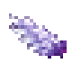
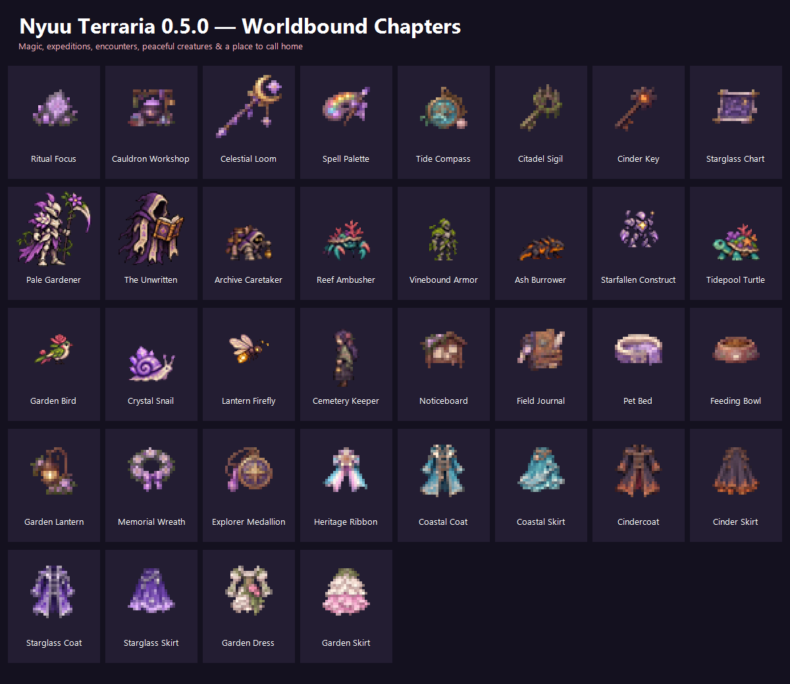

<div align="center">


# Nyuu Terraria

### Magic to master. Places to discover. A character all your own.

**v0.5.3 · Living Worlds** &nbsp;|&nbsp; **tModLoader 1.4.5-dev**

[**Download the mod**](downloads/NyuuTerraria.tmod) · [**Showcase save**](downloads/NyuuTerraria-Showcase.zip) · [**Source**](downloads/NyuuTerraria-Source.zip)


</div>

---

Nyuu Terraria adds a magic progression, six portal destinations, a wardrobe with hairstyles
and outfits, backpacks, creatures and a guide named Lyra who hands out requests. Everything is
optional — you can ignore the story and just build.

## Install

1. Copy `NyuuTerraria.tmod` into `Documents/My Games/Terraria/tModLoader-dev/Mods`.
2. Enable **Nyuu Terraria** in the mods menu and reload.
3. Play in a backed-up world, or import the [showcase save](docs/SHOWCASE.md) to see everything at once.

Every player on a server needs the same game branch and the same mod version.

## Controls

| Key | Opens |
| --- | --- |
| **L** | Chronicle — requests, stories, profiles, professions, wildlife |
| **K** | Spellbook and casting modes |
| **V** | Backpack storage (arrows page through it) |
| **G** | Active profession ability |
| **Escape** | Close the Chronicle |

Equip a backpack on the **Equipment / pets tab**, in its own Backpack slot. Rebind anything under
Settings → Controls → Mod Controls.

**Shift + left click** any inventory item while the backpack is open to send it straight into the
backpack; it tops up matching stacks first, then uses the first free slot.

## Start here

| Goal | Read |
| --- | --- |
| Get going | [Getting started](docs/GETTING-STARTED.md) |
| Learn the systems | [Player handbook](docs/PLAYER-GUIDE.md) |
| See every item and recipe | [Items](docs/ITEMS.md) |
| Find a destination | [Six destinations](docs/DESTINATIONS.md) |
| Understand magic and quests | [Worldbound](docs/WORLDBOUND.md) |
| Meet the creatures | [Creatures](docs/CREATURES.md) |
| Look at the plan | [Roadmap](docs/ROADMAP.md) |
| Author content | [Content authoring](docs/CONTENT-AUTHORING.md) |

## What's new in v0.5.3

| Area | Change |
| --- | --- |
| Pets | All six companions and the mooncap minion now play four distinct animation frames instead of a single static pose. |
| Outfits | The seven coats and seven leg pieces keep their original silhouettes but gain rim lighting, soft edge shade and one distinguishing accent each. |
| Backpack | Shift + left click moves an inventory item into the open backpack, stacking onto matching items first. |
| Bosses | The nine boss sprites are drawn larger so their on-screen size matches the hitbox they already used. |
| Creatures | Seven small enemies are drawn at a size that matches their hitbox. |

Full notes: [docs/releases/v0.5.3.md](docs/releases/v0.5.3.md)

## Build from source

```
git clone https://github.com/Nyuukoria/Nyuu-Terraria
```

Move (or link) the `NyuuTerraria` folder into
`Documents/My Games/Terraria/tModLoader/ModSources`, then **Workshop → Develop Mods → Build + Reload**.
The build needs the .NET SDK, not just the runtime. The output replaces
`Documents/My Games/Terraria/tModLoader-dev/Mods/NyuuTerraria.tmod`.

## Contributing

The rules that keep new content consistent — 2-pixel grid, sheet sizes, 14-row hair sheets,
four stacked Lyra frames — are in [docs/CONTENT-AUTHORING.md](docs/CONTENT-AUTHORING.md).
Anything that follows them drops into the existing systems without new code.
