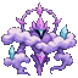
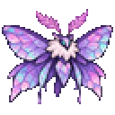
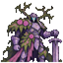
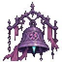
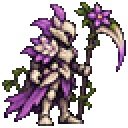
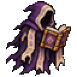

<div align="center">


# Nyuu Terraria

**Magic to master. Places to discover. A character all your own.**

A cozy-but-dangerous content mod for Terraria: cloud-born magic, six portal destinations,<br>
nine bosses, a full wardrobe, backpacks, and a guide named Lyra with stories to tell.


### [⬇️ Download the mod](https://github.com/Nyuukoria/Nyuu-Terraria/raw/refs/heads/main/downloads/NyuuTerraria.tmod) &nbsp;·&nbsp; [🗺️ Showcase save](docs/SHOWCASE.md) &nbsp;·&nbsp; [📖 Player guide](docs/PLAYER-GUIDE.md)

<br>








</div>

---

## ✨ What's inside

<table>
<tr>
<td width="50%" valign="top">

### 🔮 Spellcraft
Elemental tomes, charged blooms, crescent wards and element reactions.
Open your **Spellbook** with <kbd>K</kbd> and pick a casting mode.

</td>
<td width="50%" valign="top">

### 🌀 Six destinations
Portal pockets inside your own world: the **Reverie**, the **Hush**, **Tidepool Hollows**,
the **Overgrown Citadel**, **Cinderwood Depths** and the **Starglass Expanse**.

</td>
</tr>
<tr>
<td valign="top">

### 👑 Bosses and creatures
Nine bosses, minibosses and rematches, plus peaceful wildlife you can feed, house and observe.

</td>
<td valign="top">

### 👗 A character all your own
Coats, dresses, skirts and armor, eight long hairstyles, a **Prism Wardrobe** for saved looks,
and pets that follow you around.

</td>
</tr>
<tr>
<td valign="top">

### 🎒 Backpacks
Six sizes from 20 to 100 slots in their own equipment slot. <kbd>Shift</kbd> + click
sends items straight in.

</td>
<td valign="top">

### 📜 Lyra and the Chronicle
Requests, stories, professions with talent trees, and a journal of everything you've found.
Open it with <kbd>L</kbd>.

</td>
</tr>
</table>

<div align="center">

</div>

---

## 🚀 Quick start

1. **Download** [`NyuuTerraria.tmod`](https://github.com/Nyuukoria/Nyuu-Terraria/raw/refs/heads/main/downloads/NyuuTerraria.tmod).
2. **Copy it** into `Documents/My Games/Terraria/tModLoader-dev/Mods`.
3. **Enable** *Nyuu Terraria* in the Mods menu and reload.
4. **Play.** Use a backed-up world, or load the [showcase save](docs/SHOWCASE.md) to see everything at once.

> [!TIP]
> New here? [Getting started](docs/GETTING-STARTED.md) walks you through the first hour, from
> your first Skylight ore to your first portal.

> [!NOTE]
> Everyone on a server needs the same game branch and the same mod version.

---

## 🎮 Controls

| Key | What it does |
| :---: | --- |
| <kbd>L</kbd> | **Chronicle**: requests, stories, profiles, professions, wildlife |
| <kbd>K</kbd> | **Spellbook** and casting modes |
| <kbd>V</kbd> | **Backpack** storage (arrows page through it) |
| <kbd>G</kbd> | Your active **profession ability** |
| <kbd>Shift</kbd> + click | Send an inventory item into the open backpack |
| <kbd>Esc</kbd> | Close the Chronicle |

Equip a backpack in its own slot on the **Equipment / pets** tab. You can rebind any key under
*Settings → Controls → Mod Controls*.

---

## 📚 Guides

| I want to… | Read |
| --- | --- |
| Get going fast | [Getting started](docs/GETTING-STARTED.md) |
| Learn every system | [Player handbook](docs/PLAYER-GUIDE.md) |
| Look up items and recipes | [Items](docs/ITEMS.md) |
| Find a destination | [Six destinations](docs/DESTINATIONS.md) |
| Understand magic and quests | [Worldbound](docs/WORLDBOUND.md) |
| Meet the creatures | [Creatures](docs/CREATURES.md) |
| See what's coming | [Roadmap](docs/ROADMAP.md) |
| Add my own content | [Content authoring](docs/CONTENT-AUTHORING.md) |

---

## 🆕 What's new in v0.5.5

| | Change |
| --- | --- |
| 🌌 **The Reverie is a dimension** | The Garden Mirror opens a whole separate world (single player): meadows, moonlit lakes, floating islands, Moonprism caves and an old observatory. Nothing is built in your sky any more. |
| 👗 **Outfits** | Real sleeves and legs in each coat's colours. |
| ⛏️ **Ores and blocks** | Ore veins, slates and walls use Terraria's exact block edges, with no more boxes or invisible holes. |
| 🏺 **Decorations** | Five redrawn, the rest cleaned up, and all of them sit on the ground instead of floating. |
| 🗺️ **Showcase** | New [Showcase 055](docs/SHOWCASE.md) save with a decoration gallery. |

📄 Full notes: [docs/releases/v0.5.5.md](docs/releases/v0.5.5.md) · Older versions: [docs/releases](docs/releases)

---

<details>
<summary><b>🖼️ More previews</b></summary>
<br>

<div align="center">

**Spellcraft**<br>


**Backpacks and the Hollowglass Reach**<br>


**Skylight gear**<br>


</div>
</details>

<details>
<summary><b>🛠️ Build from source</b></summary>
<br>

```bash
git clone https://github.com/Nyuukoria/Nyuu-Terraria
```

1. Move or link the `NyuuTerraria` folder into `Documents/My Games/Terraria/tModLoader/ModSources`.
2. In tModLoader, open **Workshop → Develop Mods** and click **Build + Reload**.
3. The new build replaces `Documents/My Games/Terraria/tModLoader-dev/Mods/NyuuTerraria.tmod`.

You need the **.NET SDK**, not just the runtime.
</details>

<details>
<summary><b>❓ FAQ</b></summary>
<br>

**Will it break my world?**<br>
Destinations are built in free space in your existing world, and the generator never clears
terrain to make room. Still, back up your world first.

**Can I skip the story?**<br>
Yes. Everything is optional. Ignore Lyra and just build if you like.

**Where do I find the first ore?**<br>
Skylight ore spawns in stone below the surface, and Frostveil spawns in ice and snow. See
[Getting started](docs/GETTING-STARTED.md).
</details>

---

<div align="center">

Made with 💜 by **Nyuukoria**

<sub>Found a bug? <a href="https://github.com/Nyuukoria/Nyuu-Terraria/issues">Open an issue</a>.</sub>

</div>
