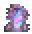
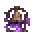
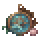
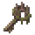
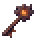
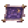

# Portal destinations

[Home](../README.md) · [Progression](GETTING-STARTED.md) · [Recipes](ITEMS.md)

Six destinations, each with its own travel key, terrain, loot and atmosphere. Choose a place below for its entry recipe, progression gate and next steps.

| Destination | Entry item | Progression | Character |
| --- | --- | --- | --- |
| [The Reverie](destinations/REVERIE.md) |  Garden Mirror | Early expedition | Lavender sky |
| [The Hush](destinations/HUSH.md) |  Cracked Bell Portal | Access after acquiring Moonprism and Bone; later encounters require Hardmode or Plantera | Dark sky |
| [Tidepool Hollows](destinations/TIDEPOOL.md) |  Tide Compass | Early expedition | Teal sky |
| [Overgrown Citadel](destinations/CITADEL.md) |  Citadel Sigil | Early expedition; prepare before challenging its boss | Green sky |
| [Cinderwood Depths](destinations/CINDERWOOD.md) |  Cinder Key | Defeat Skeletron | Ember sky |
| [Starglass Expanse](destinations/STARGLASS.md) |  Starglass Chart | Defeat Moon Lord | Indigo sky |

## Space, travel and existing saves

These are portal-accessed regions in the **same world**, rather than separate world files. Fresh placement reserves **96 tiles horizontally or 16 vertically** between destination boundaries. The search checks tiles, walls and liquids before building; it can refuse travel when a world has no suitable free area. The generator never clears existing terrain to force a destination into place.

All six now have distinct sky colors and atmospheric particles. The sky fades back when you leave. Existing saved regions are not relocated, keeping your builds and loot changes intact. Import [Nyuu Showcase 052](SHOWCASE.md) for the newly spaced layout.

Use a travel item again to return. Destinations persist with the world; journal discoveries persist with your character. Travel has a brief cooldown and is blocked during boss fights.
