# Item and recipe reference — v0.5.0

[Player guide](../README.md) · [Worldbound guide](WORLDBOUND.md)

All **145 items** registered by the playable mod. Recipes below were exported from the running game. Recipe groups can accept alternatives described in the player guide. An item without a recipe is found, dropped, purchased, or awarded; use the location guides linked below.

[Material locations](../README.md#where-to-find-materials) · [Bosses](../README.md#boss-progression) · [Quests and expeditions](WORLDBOUND.md)

Backpack upgrades additionally require **empty backpack storage**. Copper accepts the chest recipe group. Backpack metal upgrades specifically require the named bars.

## Accessories

| Item | Ingredients → output | Station |
| --- | --- | --- |
| 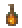 **Amberheart Pendant** | 5 Ember Amber Bar + 2 Chain → 1 | Anvils |
| 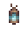 **Archive Lantern** | 4 Echo Fragment + 5 Torch + 3 Iron Bar → 1 | Anvils |
| 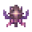 **Challenge Laurel** | Found / drop / reward — see the guides | — |
|  **Cloudweave Belt** | 4 Skylight Bar + 12 Cloud + 5 Silk → 1 | Anvils |
| 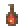 **Deepheart Pendant** | 1 Amberheart Pendant + 8 Soul of Night + 8 Soul of Light + 5 Ember Amber Bar → 1 | MythrilAnvil |
| 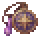 **Explorer Medallion** | Found / drop / reward — see the guides | — |
| 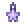 **Frostveil Sigil** | 3 Frostveil Bar + 8 Snow Block → 1 | Anvils |
| 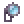 **Glowglass Lens** | 2 Skylight Bar + 1 Lens + 3 Glowstick → 1 | Anvils |
| 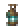 **Grotto Lantern** | 4 Verdigris Bar + 6 Glowstick → 1 | Anvils |
| 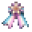 **Heritage Ribbon** | Found / drop / reward — see the guides | — |
|  **Mastery Crest** | Found / drop / reward — see the guides | — |
| 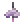 **Nimbus Charm** | 3 Warden Core + 8 Cloud → 1 | Anvils |
| 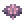 **Petal Brooch** | 3 Skylight Bar + 2 Daybloom → 1 | Anvils |
| 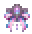 **Pride Ribbon** | 3 Silk + 1 Fallen Star → 1 | Loom |
| 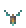 **Resonance Charm** | 4 Prism Heart + 4 Hollowglass Bar → 1 | Anvils |
| 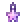 **Starfall Pendant** | 3 Stormglass Bar + 2 Fallen Star → 1 | Anvils |
| 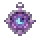 **Ward Sigil** | 3 Moonprism Bar + 2 Lens + 4 Silk → 1 | Anvils |
| 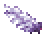 **Wings of Democloud** | 20 Cloud + 10 Demonite Bar → 1 | Anvils |

## Backpacks

| Item | Ingredients → output | Station |
| --- | --- | --- |
| 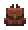 **Copper Backpack** | 12 Copper Bar + 1 Chest → 1 | Anvils |
| 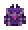 **Demonite Backpack** | 20 Demonite Bar + 1 Obsidian Backpack → 1 | Anvils |
| 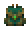 **Emerald Backpack** | 8 Emerald + 1 Gold Backpack → 1 | Anvils |
| 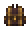 **Gold Backpack** | 12 Gold Bar + 1 Iron Backpack → 1 | Anvils |
| 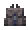 **Iron Backpack** | 12 Iron Bar + 1 Copper Backpack → 1 | Anvils |
| 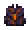 **Obsidian Backpack** | 30 Obsidian + 1 Emerald Backpack → 1 | Anvils |

## Building

| Item | Ingredients → output | Station |
| --- | --- | --- |
| 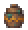 **Amber Urn** | 5 Clay Block + 1 Ember Amber Ore → 1 | Furnaces |
| 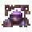 **Cauldron Workshop** | 10 Iron Bar + 5 Wood → 1 | WorkBenches |
| 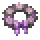 **Cinder Memorial** | 10 Obsidian + 5 Wood → 1 | WorkBenches |
| 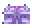 **Cloudvault** | 1 Skylight Chest + 4 Stormglass Bar + 4 Frostveil Bar + 10 Cloud → 1 | WorkBenches |
| 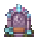 **Copper Memorial** | 4 Copper Bar + 15 Stone Block → 1 | WorkBenches |
|  **Discovery Plaque** | 10 Stone Block + 5 Wood → 1 | WorkBenches |
| 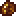 **Ember Amber Ore** | Found / drop / reward — see the guides | — |
| 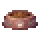 **Feeding Bowl** | 8 Clay Block + 5 Wood → 1 | WorkBenches |
|  **Frostveil Ore** | Found / drop / reward — see the guides | — |
|  **Garden Lantern** | 6 Glass + 5 Wood → 1 | WorkBenches |
|  **Glass Slate** | 10 Stone Block + 2 Glass → 10 | Furnaces |
| 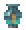 **Glass Vase** | 4 Glass + 1 Hollowglass Ore → 1 | Furnaces |
| 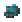 **Hollowglass Ore** | Found / drop / reward — see the guides | — |
|  **Memorial Wreath** | 5 Daybloom + 5 Wood → 1 | WorkBenches |
| 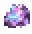 **Moonprism Ore** | Found / drop / reward — see the guides | — |
| 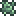 **Moss Slate** | 10 Stone Block + 1 Glowing Mushroom → 10 | WorkBenches |
| 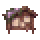 **Noticeboard** | 20 Wood + 5 Wood → 1 | WorkBenches |
| 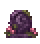 **Obsidian Memorial** | 15 Obsidian + 2 Daybloom → 1 | WorkBenches |
| 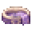 **Pet Bed** | 8 Silk + 5 Wood → 1 | WorkBenches |
| 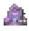 **Prism Memorial** | 20 Stone Block + 2 Moonprism Bar + 2 Daybloom → 1 | WorkBenches |
| 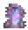 **Prism Wardrobe** | 25 Wood + 10 Glass + 5 Silk → 1 | WorkBenches |
| 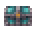 **Reach Chest** | 8 Glass Slate + 2 Hollowglass Bar → 1 | WorkBenches |
| 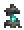 **Reach Lantern** | 1 Hollowglass Bar + 2 Torch → 1 | WorkBenches |
| 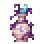 **Reverie Vase** | 5 Clay Block + 1 Moonprism Ore → 1 | Furnaces |
| 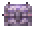 **Skylight Chest** | 8 Wood + 2 Skylight Bar → 1 | WorkBenches |
| 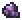 **Skylight Ore** | Found / drop / reward — see the guides | — |
|  **Starglass Memorial** | 5 Fallen Star + 5 Wood → 1 | WorkBenches |
|  **Stormglass Ore** | Found / drop / reward — see the guides | — |
|  **Tidal Memorial** | 8 Coral + 5 Wood → 1 | WorkBenches |
| 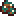 **Verdigris Ore** | Found / drop / reward — see the guides | — |

## Consumables

| Item | Ingredients → output | Station |
| --- | --- | --- |
| 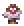 **Cloud Idol** | 30 Cloud + 3 Skylight Bar → 1 | Anvils |
| 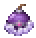 **Cloudy Bomb** | 1 Bomb + 4 Cloud + 4 Silver Bar → 1 | By hand |
| 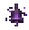 **Cracked Bell Sigil** | 8 Echo Fragment + 10 Obsidian → 1 | Anvils |
| 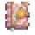 **Dawnmend Tome** | 1 Book + 2 Moonprism Bar + 5 Daybloom + 3 Lesser Healing Potion → 1 | WorkBenches |
| 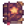 **Emberbloom Tome** | 1 Book + 2 Ember Amber Bar + 10 Torch → 1 | Anvils |
| 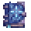 **Frostbloom Tome** | 1 Book + 3 Frostveil Bar + 5 Shiverthorn → 1 | Anvils |
|  **Glassbound Seal** | 4 Hollowglass Bar + 2 Fallen Star → 1 | Anvils |
|  **Hearth Infusion** | 1 Bottled Water + 1 Daybloom + 1 Cinder Bloom → 1 | CauldronWorkshopTile |
|  **Moonwell Infusion** | 1 Bottled Water + 1 Daybloom + 1 Tide Pearl → 1 | CauldronWorkshopTile |
|  **Prism Cocoon** | 6 Prism Wing Scale + 5 Soul of Light → 1 | Anvils |
|  **Reef Shell** | 10 Coral + 3 Seashell → 1 | WorkBenches |
|  **Resonating Bell** | 3 Prism Heart + 5 Hollowglass Bar + 10 Obsidian → 1 | Anvils |
|  **Ritual Focus** | 2 Moonprism Bar + 2 Fallen Star → 3 | Anvils |
|  **Rootbound Seal** | 5 Moonprism Bar + 3 Vine → 1 | Anvils |
|  **Starfocus Infusion** | 1 Bottled Water + 1 Daybloom + 1 Starglass Shard → 1 | CauldronWorkshopTile |
|  **Sticky Cloudy Bomb** | 1 Cloudy Bomb + 1 Gel → 1 | By hand |
|  **Stormglass Tome** | 1 Book + 4 Stormglass Bar + 3 Fallen Star + 1 Lens → 1 | Anvils |
|  **Tideglass Tome** | 1 Book + 3 Moonprism Bar + 5 Coral + 3 Bottled Water → 1 | Anvils |

## Materials and tools

| Item | Ingredients → output | Station |
| --- | --- | --- |
|  **Amber Wisp Seed** | Found / drop / reward — see the guides | — |
|  **Archive Relic** | Found / drop / reward — see the guides | — |
|  **Chronicle Journal** | 8 Wood + 2 Silk → 1 | WorkBenches |
|  **Cinder Bloom** | Found / drop / reward — see the guides | — |
|  **Cinder Key** | 20 Obsidian + 5 Hellstone Bar → 1 | Anvils |
|  **Citadel Sigil** | 5 Moonprism Bar + 3 Vine → 1 | Anvils |
|  **Cloud Satchel** | 4 Skylight Bar + 8 Cloud + 6 Silk → 1 | Loom |
|  **Cracked Bell Portal** | 6 Moonprism Bar + 20 Obsidian + 10 Bone → 1 | Anvils |
|  **Dew Berry Charm** | 3 Moonprism Bar + 3 Daybloom → 1 | WorkBenches |
|  **Echo Fragment** | Found / drop / reward — see the guides | — |
|  **Ember Amber Bar** | 3 Ember Amber Ore → 1 | Furnaces |
| ↳ Alternative | 1 Amber + 1 Gold Bar → 1 | Furnaces |
| ↳ Alternative | 1 Amber + 1 Platinum Bar → 1 | Furnaces |
|  **Field Journal** | 1 Book + 2 Silk → 1 | WorkBenches |
|  **Frostveil Bar** | 3 Frostveil Ore → 1 | Furnaces |
| ↳ Alternative | 1 Skylight Bar + 6 Ice Block → 1 | Furnaces |
|  **Garden Festival Bell** | 5 Pale Bloom + 5 Daybloom → 1 | WorkBenches |
|  **Garden Mirror** | 20 Glass + 5 Fallen Star + 8 Silk → 1 | WorkBenches |
|  **Gardener Invitation** | 8 Pale Bloom + 5 Daybloom → 1 | Anvils |
|  **Gardener Relic** | Found / drop / reward — see the guides | — |
|  **Glowcap Spore** | Found / drop / reward — see the guides | — |
|  **Hollowglass Bar** | 3 Hollowglass Ore → 1 | Furnaces |
| ↳ Alternative | 4 Glass + 1 Silver Bar + 1 Amethyst → 1 | Furnaces |
| ↳ Alternative | 4 Glass + 1 Tungsten Bar + 1 Amethyst → 1 | Furnaces |
|  **Moonprism Bar** | 3 Moonprism Ore → 1 | Furnaces |
|  **Nyuu Spellbook** | 1 Book + 2 Silk + 2 Fallen Star → 1 | WorkBenches |
|  **Pale Bloom** | Found / drop / reward — see the guides | — |
|  **Pocket Chime** | 2 Resonant Clapper + 3 Hollowglass Bar → 1 | Anvils |
|  **Pride Moth Charm** | 8 Silk + 4 Moonprism Bar → 1 | Loom |
|  **Prism Heart** | Found / drop / reward — see the guides | — |
|  **Prism Wing Scale** | Found / drop / reward — see the guides | — |
|  **Rematch Sigil** | 3 Gardener Relic + 2 Archive Relic → 1 | Anvils |
|  **Resonant Clapper** | Found / drop / reward — see the guides | — |
|  **Skylight Bar** | 3 Skylight Ore → 1 | Furnaces |
| ↳ Alternative | 2 Iron Bar + 3 Cloud → 1 | Furnaces |
|  **Spell Palette** | 5 Glass + 3 Fallen Star + 2 Silk → 1 | Loom |
|  **Starglass Chart** | 5 Luminite Bar + 15 Fallen Star → 1 | LunarCraftingStation |
|  **Starglass Shard** | Found / drop / reward — see the guides | — |
|  **Starlit Beacon** | 10 Starglass Shard + 2 Luminite Bar → 1 | LunarCraftingStation |
|  **Stormglass Bar** | 3 Stormglass Ore → 1 | Furnaces |
| ↳ Alternative | 1 Skylight Bar + 1 Demonite Bar + 2 Cloud → 1 | Furnaces |
|  **Tide Compass** | 8 Coral + 10 Glass + 2 Fallen Star → 1 | WorkBenches |
|  **Tide Pearl** | Found / drop / reward — see the guides | — |
|  **Unwritten Page** | 2 Archive Relic + 10 Echo Fragment → 1 | Anvils |
|  **Verdigris Bar** | 3 Verdigris Ore → 1 | Furnaces |
| ↳ Alternative | 1 Iron Bar + 1 Copper Bar + 2 Glowing Mushroom → 1 | Furnaces |
|  **Warden Core** | Found / drop / reward — see the guides | — |

## Outfits and armor

| Item | Ingredients → output | Station |
| --- | --- | --- |
|  **Cinder Skirt** | 10 Silk + 3 Cinder Bloom → 1 | Loom |
|  **Cindercoat** | 10 Silk + 3 Cinder Bloom → 1 | Loom |
|  **Cloud Beret** | 5 Silk + 3 Cloud → 1 | Loom |
|  **Cloudtail Coat** | 5 Silk + 3 Cloud → 1 | Loom |
|  **Cloudtail Trousers** | 5 Silk + 3 Cloud → 1 | Loom |
|  **Coastal Coat** | 10 Silk + 3 Tide Pearl → 1 | Loom |
|  **Coastal Skirt** | 10 Silk + 3 Tide Pearl → 1 | Loom |
|  **Garden Dress** | 10 Silk + 3 Pale Bloom → 1 | Loom |
|  **Garden Skirt** | 10 Silk + 3 Pale Bloom → 1 | Loom |
|  **Prism Longcoat** | 10 Silk + 2 Moonprism Bar → 1 | Loom |
|  **Prism Skirt** | 10 Silk + 2 Moonprism Bar → 1 | Loom |
|  **Starglass Coat** | 10 Silk + 3 Starglass Shard → 1 | Loom |
|  **Starglass Skirt** | 10 Silk + 3 Starglass Shard → 1 | Loom |
|  **Warden Crown** | 5 Skylight Bar + 2 Warden Core → 1 | Anvils |
|  **Warden Greaves** | 6 Skylight Bar + 2 Warden Core → 1 | Anvils |
|  **Warden Mantle** | 8 Skylight Bar + 2 Warden Core → 1 | Anvils |
|  **Yuuki's Anti Fall Damage Boots** | 15 Demonite Bar + 10 Shadow Scale + 10 Cloud → 1 | Anvils |

## Weapons

| Item | Ingredients → output | Station |
| --- | --- | --- |
|  **Aetherloom Wand** | 3 Skylight Bar + 8 Wood + 2 Fallen Star → 1 | Anvils |
|  **Amberflare Staff** | 7 Ember Amber Bar + 3 Verdigris Bar + 8 Torch → 1 | Anvils |
|  **Celestial Loom** | 15 Starglass Shard + 3 Archive Relic + 8 Luminite Bar → 1 | LunarCraftingStation |
|  **Coral Boomerang** | 8 Coral + 15 Wood → 1 | WorkBenches |
|  **Dawnpetal Staff** | 5 Skylight Bar + 3 Daybloom + 8 Wood → 1 | Anvils |
|  **Echo Scythe** | 12 Echo Fragment + 8 Moonprism Bar → 1 | Anvils |
|  **Frostveil Blade** | 9 Frostveil Bar + 10 Cloud → 1 | Anvils |
|  **Glassedge Blade** | 8 Hollowglass Bar + 2 Emerald → 1 | Anvils |
|  **Hollowchime Staff** | 5 Resonant Clapper + 10 Hollowglass Bar + 3 Fallen Star → 1 | Anvils |
|  **Mooncap Scepter** | 5 Moonprism Bar + 15 Glowing Mushroom + 10 Wood → 1 | Anvils |
|  **Moonprism Bow** | 7 Moonprism Bar + 12 Wood → 1 | Anvils |
|  **Prism Moth Staff** | 10 Moonprism Bar + 4 Fallen Star + 12 Wood → 1 | Anvils |
|  **Skylight Saber** | 7 Skylight Bar + 1 Fallen Star → 1 | Anvils |
|  **Staff of Democloud** | 25 Demonite Bar + 50 Cloud + 15 Wood → 1 | Anvils |
|  **Stormglass Scepter** | 8 Stormglass Bar + 12 Cloud + 2 Fallen Star → 1 | Anvils |
|  **Stormweaver Staff** | 7 Skylight Bar + 4 Warden Core + 15 Cloud → 1 | Anvils |
|  **Verdigris Pickaxe** | 8 Verdigris Bar + 4 Wood → 1 | Anvils |
