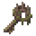

# Overgrown Citadel

[All destinations](../DESTINATIONS.md) · [Home](../../README.md) · [Every recipe](../ITEMS.md)

**Green sky, native trees, garden terrain and a ruined landmark.**

| Prepare | Details |
| --- | --- |
| Entry and return | **Citadel Sigil**; use it again to leave |
| Craft | Anvil: 5 Moonprism Bars + 3 Vines |
| Progression | Early expedition; prepare before challenging its boss |
| Resources | Pale Blooms and Gardener Relics |
| Inhabitants and encounters | Vinebound Armor, Garden Bird and the Pale Gardener |

## What to do

1. Bring healing, mana, a light source and mobility equipment. Boss fights prevent portal travel.
2. Explore the themed terrain, collect resources and find the destination's finite loot chest.
3. Open **L → Requests** to track related discoveries and story progress. Claim completed requests from that page.
4. Prepare before summoning encounters; check the [encounter and system guide](../WORLDBOUND.md#encounters-and-preparation) for requirements and tactics.

## How this place is saved

This destination occupies its own region inside your current world. Its coordinates, terrain changes and loot remain saved. v0.5.2 adds a distinct sky and wider placement buffers for newly created areas; existing areas are preserved. [Spacing and travel details](../DESTINATIONS.md#space-travel-and-existing-saves).
