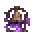

# The Hush

[All destinations](../DESTINATIONS.md) · [Home](../../README.md) · [Every recipe](../ITEMS.md)

**A world of its own under a starless sky: an abandoned mining town, a mine shaft down to a forgotten archive, and a dark manor on the eastern ridge. Scares follow the configured setting.**

| Prepare | Details |
| --- | --- |
| Entry and return | **Cracked Bell Portal**; use it again inside the Hush to go home |
| Craft | Anvil: 6 Moonprism Bars + 20 Obsidian + 10 Bone |
| Progression | Access after acquiring Moonprism and Bone; later encounters require Hardmode or Plantera |
| Resources | Echo Fragments and Archive Relics |
| Inhabitants and encounters | Lantern Stalker, Paper Wraith, Mourning Bell, Bellkeeper, Mirrorless, Archive Caretaker and The Unwritten |

## What to do

1. Bring healing, mana, a light source and mobility equipment. Boss fights prevent portal travel.
2. Explore the themed terrain, collect resources and find the destination's finite loot chest.
3. Open **L → Requests** to track related discoveries and story progress. Claim completed requests from that page.
4. Prepare before summoning encounters; check the [encounter and system guide](../PLAYER-GUIDE.md#expedition-bosses-and-minibosses) for requirements and tactics.

## How this place is saved

**Single player:** since v0.5.6 the Hush is its own world file, like the Reverie. The portal saves your
world and loads the Hush; the first visit generates it behind a short loading screen. Use the portal
inside the Hush to come back to exactly where you left. Nothing is built in your home world.

* **Mining town** (west of the landing): six boarded-up shacks, lampposts and two supply chests.
* **Mine shaft:** a rope down from the middle of town to the **forgotten archive**, two reading
  galleries of bookshelves with a chest holding an **Archive Lantern**.
* **The manor** (east): three floors of dark rooms. The **Cracked Bell Sigil** that wakes the
  Bellkeeper waits in a chest upstairs.
* Hardmode and boss progress from your home world carries in, so the Plantera and hardmode gates match your game.

**Multiplayer:** a server runs one world, so the Hush is still a pocket region inside the shared world. [Spacing and travel details](../DESTINATIONS.md#space-travel-and-existing-saves).
