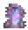

# The Reverie

[All destinations](../DESTINATIONS.md) · [Home](../../README.md) · [Every recipe](../ITEMS.md)

**A world of its own: flower meadows under a lavender sky, moonlit lakes, floating flower islands, an abandoned observatory and caves threaded with Moonprism.**

| Prepare | Details |
| --- | --- |
| Entry and return | **Garden Mirror**; use it again inside the Reverie to go home |
| Craft | Work Bench: 20 Glass + 5 Fallen Stars + 8 Silk |
| Progression | Early expedition |
| Resources | Moonprism Ore and Bars, Prism Wing Scales |
| Inhabitants and encounters | Rootbound Knight, Prism Matriarch and Reefback Guardian |

## What to do

1. Bring healing, mana, a light source and mobility equipment. Boss fights prevent portal travel.
2. Explore the themed terrain, collect resources and find the destination's finite loot chest.
3. Open **L → Requests** to track related discoveries and story progress. Claim completed requests from that page.
4. Prepare before summoning encounters; check the [encounter and system guide](../PLAYER-GUIDE.md#chronicle-expeditions) for requirements and tactics.

## How this place is saved

**Single player:** the Reverie is its own world file, like the Nether. Using the Garden Mirror saves your
world, loads the Reverie, and puts you on its landing. The first visit generates it (a short loading
screen). Use the mirror inside the Reverie to save it and return exactly where you left. Nothing is
built in your home world.

* One Reverie per home world, stored in `Worlds/NyuuDimensions/<world id>/Reverie.wld`. It does not appear in the world list.
* Boss and hardmode progress from your home world is carried in, so gates match your game.
* Quit the game inside the Reverie and you'll be put back at your return spot the next time you open your home world.
* Old saves: a Reverie sky pocket built by an earlier version stays in your world. Using the mirror while standing in it still takes you home.

**Multiplayer:** a server runs one world, so the Reverie is still a pocket region inside the shared world. [Spacing and travel details](../DESTINATIONS.md#space-travel-and-existing-saves).
