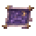

# Starglass Expanse

[All destinations](../DESTINATIONS.md) · [Home](../../README.md) · [Every recipe](../ITEMS.md)

**Indigo sky, celestial terrain, broken islands and a celestial landmark.**

| Prepare | Details |
| --- | --- |
| Entry and return | **Starglass Chart**; use it again to leave |
| Craft | Ancient Manipulator: 5 Luminite Bars + 15 Fallen Stars |
| Progression | Defeat Moon Lord |
| Resources | Starglass Shards |
| Inhabitants and encounters | Starfallen Construct and Crystal Snail |

## What to do

1. Bring healing, mana, a light source and mobility equipment. Boss fights prevent portal travel.
2. Explore the themed terrain, collect resources and find the destination's finite loot chest.
3. Open **L → Requests** to track related discoveries and story progress. Claim completed requests from that page.
4. Prepare before summoning encounters; check the [encounter and system guide](../WORLDBOUND.md#events) for requirements and tactics.

## How this place is saved

This destination occupies its own region inside your current world. Its coordinates, terrain changes and loot remain saved. v0.5.2 adds a distinct sky and wider placement buffers for newly created areas; existing areas are preserved. [Spacing and travel details](../DESTINATIONS.md#space-travel-and-existing-saves).
