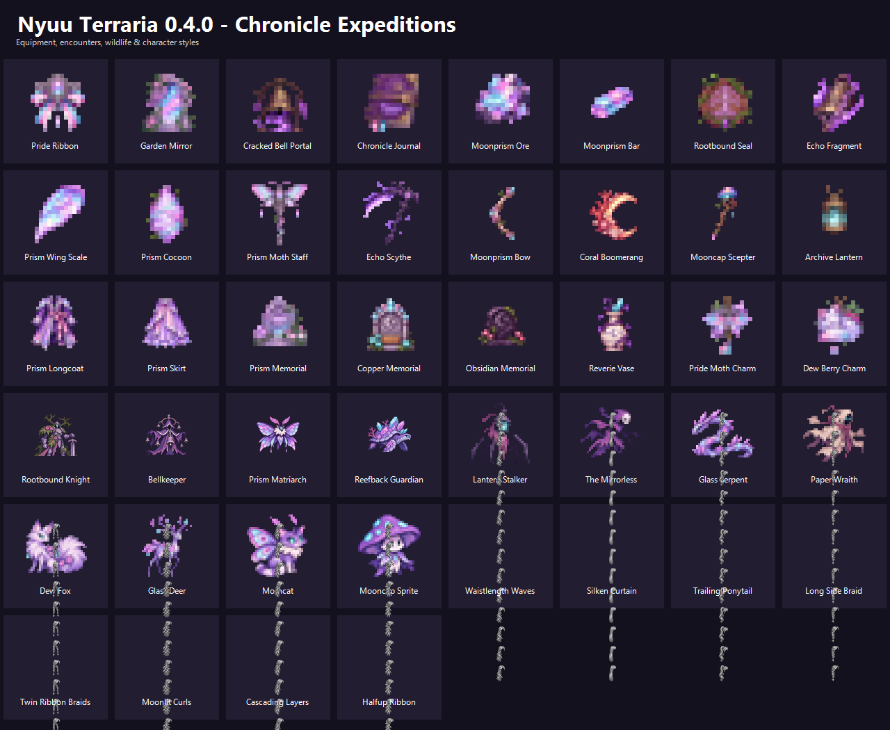

# v0.4.0

Backpack flicker and Equipment-tab placement fixes, corrected accessory scrolling, larger bar icons; Lyra, pride customization, eight long hairstyles, 12 quests, five persistent professions, Reverie/Hush pocket expeditions with optional scares, three bosses, three minibosses, wildlife, pets, Moonprism, weapons, and memorials.

## Crafting, locations and use

[Open the relevant guide section](../../README.md#chronicle-expeditions) for ingredients, stations, locations and equipment instructions.

## Where to find the details

[Current player guide](../../README.md) contains the location, crafting, equipment and boss instructions for this content. [All current recipes](../ITEMS.md) lists exact ingredients. Later versions include the earlier content and fixes.

[Full version history](../../README.md#version-notes)
