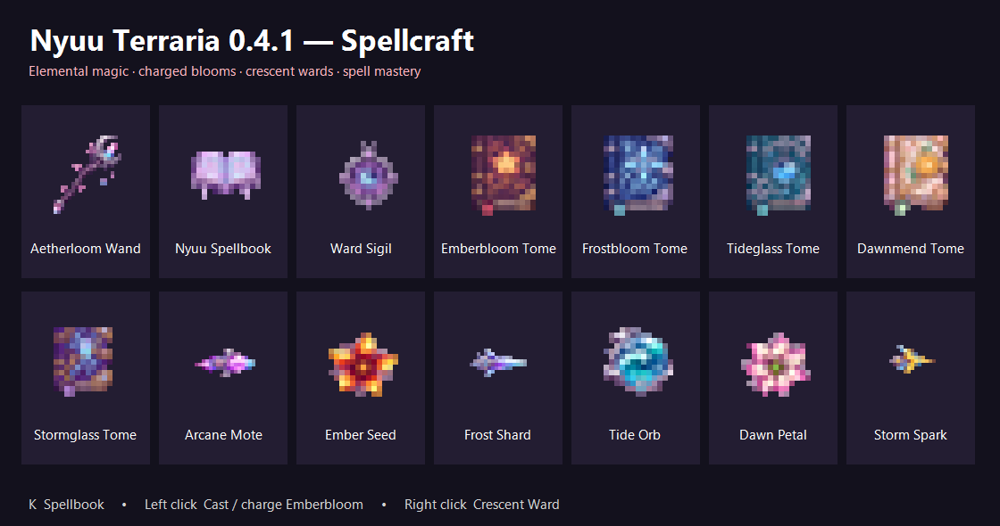

# v0.4.1

Added Aetherloom Wand, six casting modes, five learning tomes, K-key Spellbook, saved spell mastery, charged Emberbloom, piercing frost, splitting water, chained lightning, healing, Crescent Ward, Ward Sigil, and the status-table roadmap.

## Crafting, locations and use

[Open the relevant guide section](../../README.md#spellcraft) for ingredients, stations, locations and equipment instructions.

## Where to find the details

[Current player guide](../../README.md) contains the location, crafting, equipment and boss instructions for this content. [All current recipes](../ITEMS.md) lists exact ingredients. Later versions include the earlier content and fixes.

[Full version history](../../README.md#version-notes)
